# E10-S2 parity: legacy Python SVG vs draw.io render

> **Signed off by the owner on 2026-11-05.** The legacy renderer (`svg_renderer.py`, the glyph table, `legacy_svg()`)
> and the script that produced this page were deleted afterwards; these files are the frozen record of the comparison.

Left: what the blog published before
Epic 10 (hand-drawn glyphs). Right: draw.io's own export of the same `.drawio` file, which is what the blog
publishes now. Both come from the same geometry. Sign-off here allows deleting `svg_renderer.py` and the glyph
table in `icons.py`.

## AWS EKS + Argo CD + GitHub (eval-13 shape)

draw.io render 6.1 s, SVG 109 KB, PNG 433 KB, layout lint findings: 0

| Legacy (Python SVG) | draw.io render (published) |
|---|---|
| 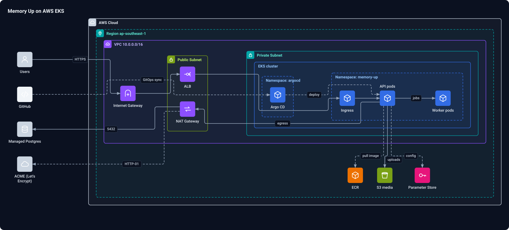 | 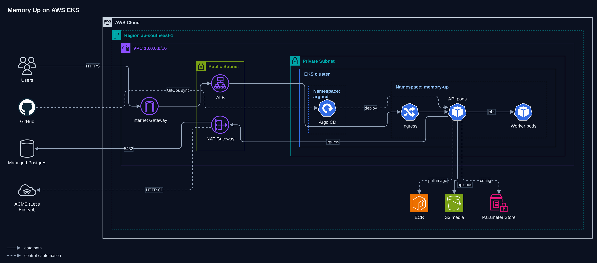 |

## Google Cloud media pipeline (eval-14 shape)

draw.io render 5.4 s, SVG 52 KB, PNG 191 KB, layout lint findings: 0

| Legacy (Python SVG) | draw.io render (published) |
|---|---|
| 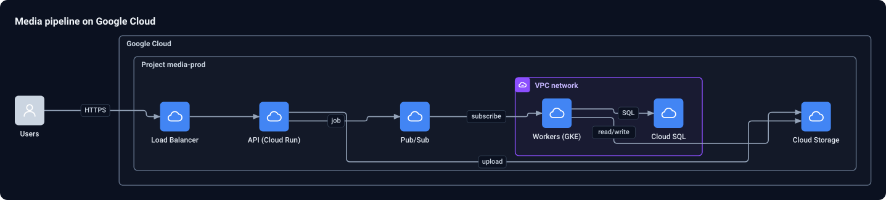 | 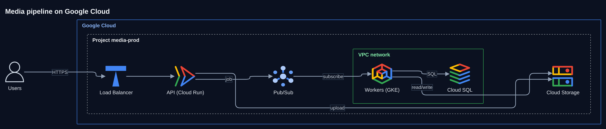 |

## Decision flowchart (eval-15 shape)

draw.io render 4.2 s, SVG 35 KB, PNG 192 KB, layout lint findings: 0

| Legacy (Python SVG) | draw.io render (published) |
|---|---|
| 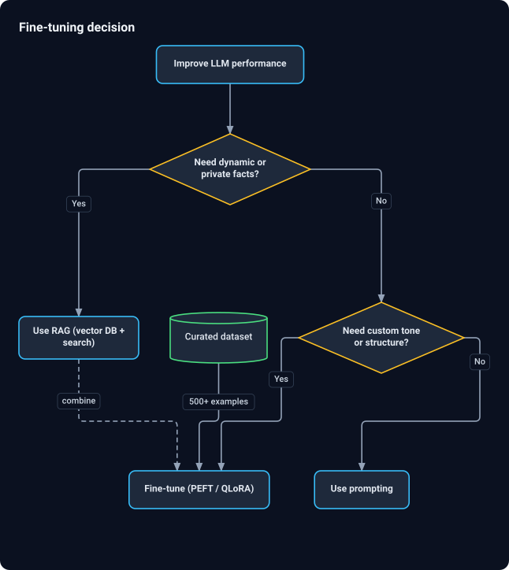 | 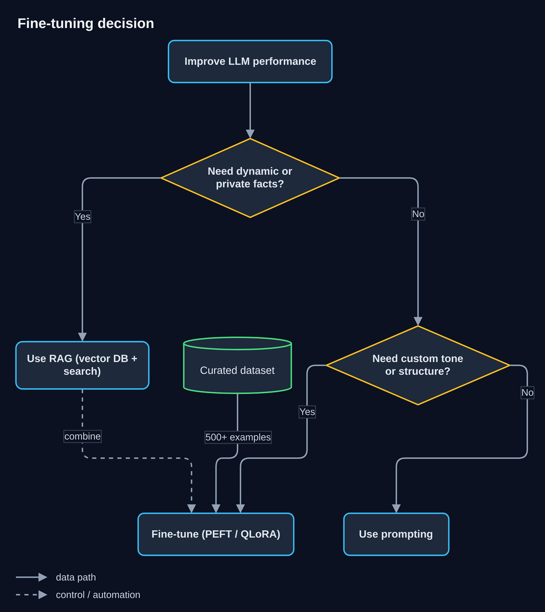 |

## Webhook sequence (eval-16 shape)

draw.io render 4.1 s, SVG 22 KB, PNG 111 KB, layout lint findings: 0

| Legacy (Python SVG) | draw.io render (published) |
|---|---|
| 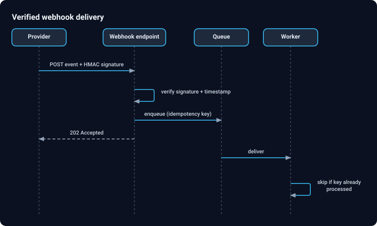 | 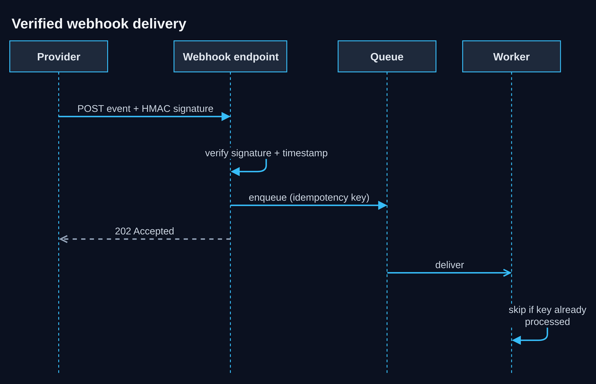 |

## Three-tier AWS web app

draw.io render 4.5 s, SVG 53 KB, PNG 175 KB, layout lint findings: 0

| Legacy (Python SVG) | draw.io render (published) |
|---|---|
| 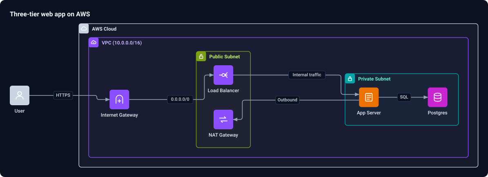 | 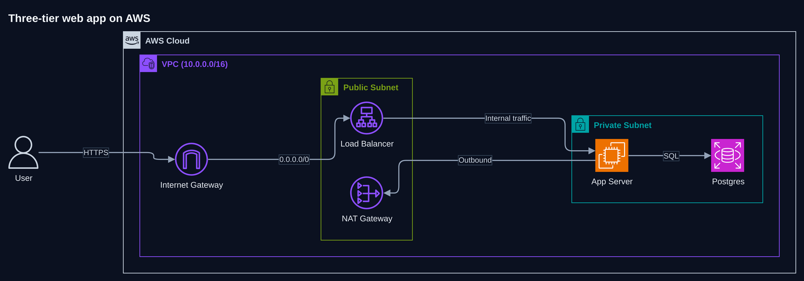 |

## Upload and transcode workflow (owner sample)

draw.io render 4.6 s, SVG 68 KB, PNG 262 KB, layout lint findings: 0

| Legacy (Python SVG) | draw.io render (published) |
|---|---|
| 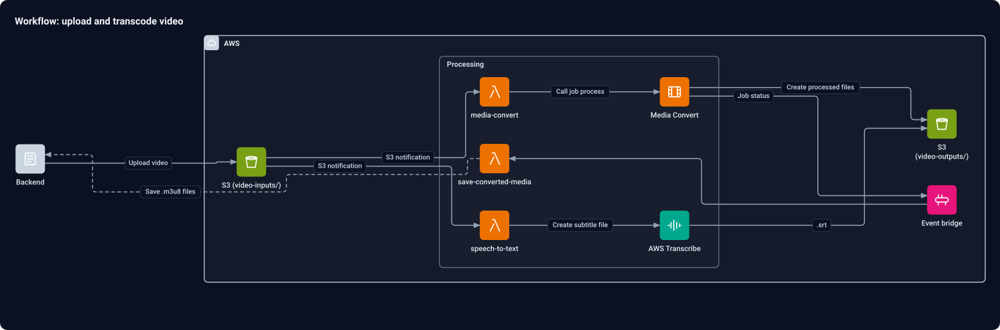 | 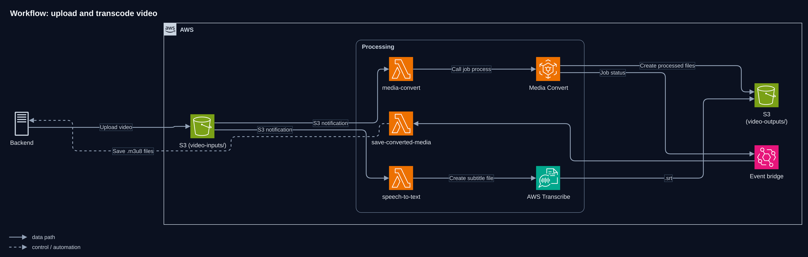 |
