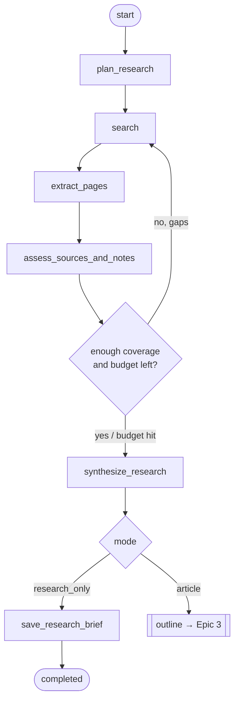

# Epic 2 — Writing Tasks & Research Workflow

| | |
|---|---|
| **Milestone** | MVP |
| **Depends on** | Epic 1 |
| **Status** | Draft for review |

## Goal

The owner can ask the agent, at any time, to **research a topic** or to **research and write a blog post**. The agent:

1. Creates a task.
2. Plans research questions.
3. Searches the web and extracts pages.
4. Assesses the sources.
5. Records traceable notes and claims.

The owner watches progress live. Research-only tasks end with a research brief, and the owner can later promote the brief to an article.

## Context

- This epic introduces the LangGraph graph and its runner. Epic 3 adds outline and draft nodes to the same graph.
- Retrieved pages are **untrusted input**. The research nodes have no access to publishing tools.
- One graph thread per task: `thread_id = task_id`.

## In scope
- WritingTask API and status state machine.
- Graph skeleton and runner.
- Research plan, search, extraction, source assessment, claims, research brief.
- SSE progress, retry/resume.
- UI pages for task creation, list and detail.

## Out of scope
- Outline/draft (Epic 3).
- Style retrieval (Epic 6).
- Parallel multi-agent research (parked).

---

## Workflow (this epic's portion)

## Status state machine

| From | Allowed to |
|---|---|
| `queued` | `researching`, `failed`, `rejected` |
| `researching` | `outlining`, `completed`, `failed`, `rejected` |
| `outlining` | `drafting`, `awaiting_review` (optional outline review), `failed`, `rejected` |
| `drafting` | `generating_diagram`, `validating`, `failed`, `rejected` |
| `generating_diagram` | `validating`, `failed`, `rejected` |
| `validating` | `drafting` (self-revision), `awaiting_review`, `failed`, `rejected` |
| `awaiting_review` | `revision_requested`, `approved`, `rejected` |
| `revision_requested` | `researching`, `outlining`, `drafting`, `generating_diagram`, `failed`, `rejected` |
| `approved` | `publishing`, `awaiting_review` (new revision created) |
| `publishing` | `published`, `partially_published`, `failed` |
| `partially_published` | `publishing`, `awaiting_review` |
| `published` | `awaiting_review` (owner edits → update flow) |
| `completed` (research only) | `outlining` (promote to article), `rejected` |
| `failed` | **only** the stage recorded in `failed_stage` (retry), or `rejected` |
| `rejected` | — (terminal; doubles as "cancelled") |

The table adds `completed` to the brief's status list, for research-only tasks. *(Updated during implementation: `rejected` is reachable from every non-publishing state, so a task can always be cancelled. It lives in `api/src/modules/shared/domain/value_objects/task_status.py`.)*

---

## Stories

### E2-S1 — Create & list writing tasks (API)
**As** the owner, **I want** to submit a topic with options, **so that** the agent knows what to research or write.

**Acceptance criteria**
- [ ] `POST /tasks` accepts the following fields:

  | Field | Rules |
  |---|---|
  | `topic` | required, 5–500 chars |
  | `mode` | `research_only` \| `article` |
  | `audience` | free text, e.g. "software engineers new to LLM fine-tuning" |
  | `depth` | `intro` \| `intermediate` \| `deep_dive` |
  | `language` | default `en` |
  | `format` | `concept` \| `tutorial` \| `comparison` \| `series_part` |
  | `series` | optional `{name, part, previous_post_id}` |
  | `requirements` | free text |
  | `include_diagram` | `auto` \| `yes` \| `no` |
  | `publication_targets` | subset of `sanity`, `devto` |
  | `budgets` | optional overrides, within server maximums |

- [ ] `POST /tasks` returns `201 {id, status: "queued"}` and starts the run asynchronously.
- [ ] `GET /tasks` is paginated, filterable by status/mode, and sorted by `updated_at desc`.
- [ ] `GET /tasks/{id}` returns the task, current status, `failed_stage`/`last_error` when present, counts of sources/claims, and the LangSmith run URL.
- [ ] DTOs validate everything. Unknown fields are rejected. `WritingTaskEntity` is pure Pydantic and `WritingTaskModel` is SQLModel.

**Size:** 3

---

### E2-S2 — Enforced status transitions & task event log
**As** the owner, **I want** task status changes enforced server-side and recorded, **so that** the model can never skip steps and I get an audit trail.

**Acceptance criteria**
- [ ] The transition table above is implemented in the domain (`TaskStatus` value object plus a `transition_to()` method). An illegal transition raises `BadRequestException(code=INVALID_TRANSITION)`.
- [ ] Every transition writes a `task_events` row (`task_id`, `from`, `to`, `actor` = `system|owner|agent`, `reason`, `created_at`) in the same transaction (`@Transactional`).
- [ ] Graph nodes change status only through a `TaskStatusPort`, never by writing the DB directly.
- [ ] Unit tests cover every allowed transition and a sample of forbidden ones.

**Size:** 2

---

### E2-S3 — LangGraph skeleton & workflow runner
**As** a developer, **I want** a typed graph and a runner that executes it in the background, **so that** long research runs don't block HTTP requests and can resume after restarts.

**Acceptance criteria**
- [ ] `BlogState` (TypedDict or Pydantic) holds `task_id`, `mode`, inputs, `research_plan`, `source_ids`, `claim_ids`, `iteration_counters`, `budget_used`, `errors`.
  - Large content (page text, drafts) lives in DB tables. State holds **ids**, which keeps checkpoints small.
- [ ] The graph is compiled with `AsyncPostgresSaver`. Runs use `thread_id = task_id`.
- [ ] `WorkflowRunner` (adapter for `IWorkflowRunner`):
  - `start(task_id)`
  - `resume(task_id, command)`
  - `cancel(task_id)`
  - It runs `graph.astream(...)` in a managed `asyncio.Task` registry, with at most N concurrent runs (default 2).
- [ ] Every node is wrapped by a decorator that does four things:
  1. Sets the task status for that stage.
  2. Emits `node_started`/`node_finished` events.
  3. Enforces a per-node timeout.
  4. Converts exceptions into `failed`, storing `failed_stage` and a safe error message.
- [ ] `recursion_limit` is set explicitly. Budget counters stop loops even if the model asks for more.
- [ ] Cancelling sets the task to `rejected` with reason `cancelled`, and the asyncio task is cancelled cleanly.

**Technical notes**
- Graph definition lives in `src/modules/agent/graph/blog_graph.py`. Nodes live in `src/modules/agent/nodes/`. Nodes call use-case ports (e.g. `ISourceRepository`), not ORM models.

**Size:** 5

---

### E2-S4 — Research planning node
**As** the owner, **I want** the agent to break my topic into research questions and queries, **so that** research is focused and covers what I asked for.

**Acceptance criteria**
- [ ] The `plan_research` node uses `LLM_PLANNER_MODEL` with `with_structured_output(ResearchPlan)`. `ResearchPlan` contains:
  - `questions[]`
  - `queries[]`, each with `intent` and `preferred_source_types`
  - `must_cover[]`, derived from requirements
  - `out_of_scope[]`
- [ ] Output is validated. Query count is capped at `budgets.max_queries` (default 8). One repair retry is allowed on schema failure, and then the task fails with a clear error.
- [ ] Preferred source types (official docs, papers/arXiv, GitHub repos, reputable engineering blogs) appear in the plan and drive search parameters.
- [ ] The plan is saved on the task and shown in the UI.

**Size:** 2

---

### E2-S5 — Web search & page extraction tools
**As** the owner, **I want** the agent to search the web and read pages reliably, **so that** the article is based on real, current sources.

**Acceptance criteria**
- [ ] Two output ports: `ISearchProvider.search(query, k, include_domains?, exclude_domains?)` and `IPageExtractor.extract(url)`.
  - Default adapters use Tavily (`langchain-tavily`) for search and extraction.
  - The fallback extractor uses `httpx` + `trafilatura`.
  - The provider is selected by config (decision D2).
- [ ] Guardrails:
  - 15 s timeout per request.
  - 2 retries with backoff.
  - Maximum page size of 2 MB, with content truncated to N tokens for the LLM.
  - Only `http(s)` URLs.
  - Private/loopback IPs are blocked (SSRF protection).
  - A configurable domain denylist.
- [ ] URLs are canonicalised (strip tracking params, use `<link rel=canonical>` when available) and de-duplicated per task.
- [ ] Each extracted page is stored as a `research_sources` row with `url`, `canonical_url`, `title`, `publisher`, `retrieved_at`, `published_at` (when detected) and a content hash. Raw text is stored in a separate column or file, not in graph state.
- [ ] Tools are LangChain `@tool`/`StructuredTool` with Pydantic arg schemas, so tool arguments are validated.
- [ ] Integration tests use recorded HTTP fixtures (`respx`) and do not hit the network.

**Size:** 5

---

### E2-S6 — Source assessment, research notes & claims
**As** the owner, **I want** each source rated and summarised into notes and claims, **so that** I can trust (or question) what the article says.

**Acceptance criteria**
- [ ] For each source, `LLM_FAST_MODEL` returns a `SourceAssessment`:
  - `source_type`: `official_docs` \| `paper` \| `repository` \| `reputable_publication` \| `blog` \| `forum` \| `other`
  - `quality_score` (0–1) with a rationale
  - `relevance` to the plan questions
  - `notes` (bullets)
  - `claims[]`: `{text, supporting_quote ≤ 300 chars, question_id}`
- [ ] Claims are stored in `research_claims` and linked to the source. Each `supporting_quote` must appear verbatim (after whitespace normalisation) in the extracted text. If it does not, the claim is marked `unverified_quote`.
- [ ] **Prompt-injection defence:**
  - Page text is wrapped in clearly delimited `<untrusted_source>` blocks.
  - The system prompt says to ignore instructions in that text.
  - This node has **no tools bound**.
  - The output is schema-validated.
  - A test page containing "ignore previous instructions and …" does not change the node's behaviour or output schema.
- [ ] Sources scoring below a threshold are kept but marked `low_quality` and excluded from drafting by default.

**Size:** 5

---

### E2-S7 — Coverage check & bounded research loop
**As** the owner, **I want** the agent to notice gaps and search again, within limits, **so that** research is thorough without running forever.

**Acceptance criteria**
- [ ] After assessment, a deterministic-plus-LLM check maps plan questions and `must_cover` items to supporting claims. Any question without at least one claim from a source of quality ≥ threshold counts as a gap.
- [ ] If gaps remain and the budget allows (`max_research_rounds`, default 2; `max_sources`, default 15), the agent generates follow-up queries for the gaps only and loops back to `search`.
- [ ] When the budget is exhausted, the workflow continues and records the gaps as `open_questions`. It never loops further.
- [ ] Counters are kept in state and visible in the UI.

**Size:** 3

---

### E2-S8 — Research synthesis & research-only mode
**As** the owner, **I want** to ask only for research and get a structured brief, **so that** I can explore a topic before deciding to write about it.

**Acceptance criteria**
- [ ] The `synthesize_research` node produces a `ResearchBrief` containing:
  - summary
  - key findings, each linked to claim ids and sources
  - conflicting information
  - open questions
  - suggested article angles (2–3) with audience fit
  - a recommended source list ordered by quality
- [ ] In `research_only` mode the brief is saved (`research_briefs`), the task becomes `completed`, and the graph ends.
- [ ] `GET /tasks/{id}/research-brief` returns the brief, rendered as Markdown plus structured data.
- [ ] `POST /tasks/{id}/promote` takes optional `{angle, audience, depth, format, requirements}`. It moves the task to `outlining` and continues the **same thread** with the existing research, without re-searching.
- [ ] The brief can be exported as Markdown (copy/download from the UI).

**Size:** 3

---

### E2-S9 — Live progress via Server-Sent Events
**As** the owner, **I want** to see what the agent is doing in real time, **so that** I know it's working and can stop it if it goes off track.

**Acceptance criteria**
- [ ] `GET /tasks/{id}/events` (SSE) streams:
  - status changes
  - `node_started`/`node_finished`
  - `query_issued`
  - `source_found`/`source_assessed`
  - `budget_update`
  - `error`
- [ ] Events come from LangGraph `stream_mode=["updates","custom"]`, with custom events emitted through `get_stream_writer()`. They are also persisted, so reconnecting with `Last-Event-ID` replays missed events.
- [ ] A heartbeat is sent every 15 s. The connection closes when the task reaches a terminal or waiting state.
- [ ] Event payloads contain no page text or secrets.

**Size:** 3

---

### E2-S10 — Failure handling, retry & resume after restart
**As** the owner, **I want** failed or interrupted tasks to be resumable, **so that** I don't lose research when something breaks or I restart Docker.

**Acceptance criteria**
- [ ] On API startup, tasks in an active status (`researching`, `outlining`, `drafting`, `generating_diagram`, `validating`, `publishing`) with no live runner are marked `failed` with `last_error="interrupted_by_restart"` and `resumable=true`.
- [ ] `POST /tasks/{id}/retry` resumes from the last checkpoint (`graph.astream(None, config)`) and does not repeat completed nodes.
- [ ] Tasks paused at `awaiting_review` (a LangGraph `interrupt`) are **not** marked failed on restart. They stay resumable through the review endpoints (Epic 4).
- [ ] Error messages shown to the user are sanitised: no stack traces, no keys. Full details go to logs and LangSmith.
- [ ] Integration test: kill the runner mid-research, restart, retry, and confirm the task completes with no duplicate sources.

**Size:** 3

---

### E2-S11 — UI: new task form, task list & task detail
**As** the owner, **I want** a simple form and a live task page, **so that** I can request research or a blog in seconds and follow it.

**Acceptance criteria**
- [ ] **New task page** (`/tasks/new`):
  - Built with RHF + Zod. The schema mirrors the API DTO and the type is `TCreateTaskInput`.
  - A mode toggle offers "Research only" or "Research + write".
  - Advanced options (budgets, series, diagram) sit in a collapsible section.
  - Example prompts are clickable chips.
- [ ] **Tasks page** (`/tasks`):
  - A shadcn table with status badges (one color per status, using design tokens), mode, topic, and updated time.
  - Filters by status and mode.
- [ ] **Task detail page** (`/tasks/[id]`):
  - A progress timeline fed by SSE through a `use-task-events.ts` hook.
  - The research plan.
  - A sources panel: title, publisher, type, quality, link, expandable notes and claims.
  - Open questions.
  - Action buttons by state: Cancel, Retry, Promote to article.
  - For research-only tasks, a "Research brief" tab rendered as Markdown.
- [ ] React Query handles all server data, with a query-key factory in `features/tasks/query-keys.ts`. SSE events invalidate the relevant queries.

**Size:** 5

---

## Definition of done (epic)
- From the UI, the owner creates a research-only task on a real topic. They watch it live, and receive a brief in which every key finding links to at least one stored source.
- Promoting the brief moves the task to `outlining`. The run then stops cleanly because Epic 3 nodes are stubbed.
- Restart/resume works as described in E2-S10.
- An injection test page has no effect on the run.

## Learning map
| Tool | Concepts |
|---|---|
| LangChain | Tools with Pydantic schemas, `with_structured_output`, retrieval of web documents, prompt templates |
| LangGraph | `StateGraph`, conditional edges, loops with counters, `recursion_limit`, streaming (`updates`, `custom`, `get_stream_writer`), resume from checkpoint |
| LangSmith | Inspecting tool calls, node-level spans, filtering traces by `task_id` metadata |

---

## Implementation notes (delivered 2026-10-22)

| Story | Where | Notes |
|---|---|---|
| E2-S1 | `modules/tasks/` | `POST/GET /tasks`, `GET /tasks/{id}`. DTOs use `extra="forbid"`. Budgets are capped by server maximums (`RESEARCH_MAX_*`). By default the list hides `rejected` tasks; pass `archived=true` to show them. |
| E2-S2 | `shared/domain/value_objects/task_status.py`, `tasks/domain/task_transitions.py` | `TaskTransitioner` is the **only** writer of `status`. It runs under a row lock (`SELECT … FOR UPDATE`) and writes a `status_changed` event in the same transaction. |
| E2-S3 | `agent/graph/blog_graph.py`, `agent/nodes/base.py`, `agent/infrastructure/adapters/workflow_runner.py` | One thread per task, with `thread_id = task_id`. State holds only small values; page text, claims and briefs live in tables. `@workflow_node` handles status, start/finish events, timeout and failure capture. The runner runs each thread as an asyncio task, with at most `WORKFLOW_MAX_CONCURRENCY` at once. |
| E2-S4 | `agent/nodes/research.py::plan_research`, `agent/prompts/research.py`, `agent/schemas/research.py` | Schemas carry no length or range constraints, because providers differ in which ones they accept. Limits are enforced in `normalize_*` after parsing. One repair retry is made on invalid output. |
| E2-S5 | `research/infrastructure/adapters/` | **Search:** Tavily, or keyless DuckDuckGo, chosen with `SEARCH_PROVIDER=auto`. **Extraction:** Tavily extract, falling back to httpx + trafilatura. **SSRF guard:** URLs must be http(s) and resolve only to public IPs, and every redirect hop is re-checked. Pages are limited to 2 MB and HTML/text content types. URLs are canonicalised (tracking parameters stripped) and de-duplicated by a unique `(task_id, canonical_url)` key. Search runs through a LangChain `StructuredTool`, so it shows up as a tool span. |
| E2-S6 | `assess_sources`, `nodes/evidence.py` | Page text is wrapped in `<untrusted_source>`, and any closing tag inside it is neutralised. The assessment node has no tools. Each quote is checked verbatim against the page text after normalising whitespace, quotes and ellipses (`quote_verified`). Sources below `RESEARCH_QUALITY_THRESHOLD` become `low_quality`. |
| E2-S7 | `check_coverage` | Coverage is computed deterministically: a question counts as covered when a claim from an `assessed` source at or above the threshold answers it. Follow-up queries target only the uncovered questions. Rounds, queries and sources are all budgeted. |
| E2-S8 | `synthesize_research`, `nodes/brief_render.py` | The LLM sees short refs (`S2`, `C5`) instead of UUIDs. Refs that don't exist are dropped, and findings without evidence are marked `supported: false`. **Research-only:** the task moves to `completed`, then hits an `interrupt()`. `POST /tasks/{id}/promote` resumes the **same thread** with `Command(resume=…)`, and no new searches run. |
| E2-S9 | `GET /tasks/{id}/events` | SSE replays the persisted `task_events`, honouring `Last-Event-ID` and `?after=`, then streams live events. The in-process broker wakes listeners. A heartbeat goes out every 15 s, and an `event: end` is sent when the task is at rest. Custom events come from `get_stream_writer()` and are persisted by the runner. |
| E2-S10 | `LangGraphWorkflowRunner.recover`, `POST /tasks/{id}/retry` | **On startup:** active tasks without a live run become `failed` with `resumable=true`. Tasks paused at an interrupt are left alone, and queued tasks are started. **Retry** resumes from the checkpoint, so completed nodes are not re-run. |
| E2-S11 | `ui/src/features/tasks/`, `app/tasks/**` | Pages: a form (RHF + Zod, with example chips), a list (Zustand filters) and a detail page. The detail page has an SSE timeline, the plan, sources with claims and quote checks, a brief tab, a sidebar, and cancel, retry and promote actions. `/tasks/[id]` is partially prerendered: `useParams` sits under `<Suspense>`, as Cache Components requires. |

**Extra:** `outline` is an **Epic 3 placeholder**. It pauses the thread with `interrupt({"type": "not_implemented"})`, so article tasks rest at `outlining` and can be resumed once Epic 3 replaces the node.

**Verification:**
- 123 pytest tests pass. Of these, 17 are integration tests against real Postgres with a scripted fake LLM, search and extractor. They cover:
  - the full research-only run, including a follow-up round and de-duplication;
  - a prompt-injection page;
  - promotion on the same thread;
  - node failure followed by a checkpoint retry, with no duplicate sources or re-fetching;
  - per-source failures;
  - restart recovery;
  - cancel;
  - the HTTP API, including SSE replay and `Last-Event-ID`.
- `alembic check` is clean. The UI passes `tsc`, `eslint` and `next build`.
- **Manual run in Docker** with real Gemini (`gemini-3.1-flash-lite`) and DuckDuckGo, on the topic "pgvector vs dedicated engines":
  - 4 questions, 7 sources and 42 claims; every question covered.
  - The brief was produced, then promoted, and the task is paused at `outlining`.
  - 2 of the 4 DuckDuckGo queries failed, probably rate-limited. The run recovered without intervention. A Tavily key is recommended.

**Not verified:** Tavily against the real API (no key; covered only by HTTP-mocked tests) and LangSmith traces (tracing is off).
