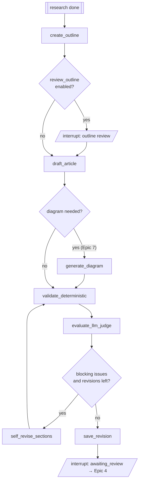

# Epic 3 — Outline, Drafting & Automated Checks

| | |
|---|---|
| **Milestone** | MVP |
| **Depends on** | Epic 2 |
| **Status** | Draft for review |

## Goal

Turn the research into an outline and then a Markdown article. The article must:

- render correctly on leon-pham.vercel.app
- follow the owner's writing style
- cite its sources
- flag unsupported claims

The article then passes deterministic and LLM checks, gets bounded self-revision, is saved as an immutable revision, and the workflow pauses for human review.

## Context — the "render contract" (confirmed from profile-ui)

Every generated article must respect what the site's renderer (`profile-ui/components/post/MarkdownComp.tsx`) supports:

| Rule | Reason |
|---|---|
| The first line is a single `# H1` title. There is no frontmatter. | The existing blog convention. The publish flow uses the H1 as the title. |
| Each paragraph is written on **one line**. Use lists for line-by-line content. | `normalizeMarkdown` merges consecutive non-block lines into one paragraph. |
| Code fence languages are limited to `bash`, `java`, `javascript`, `json`, `markdown`, `python`, `typescript`, `text` and `mermaid`. | These are the Prism grammars loaded. Others fall back to markdown highlighting. |
| Math uses `$...$` / `$$...$$` (KaTeX). | `remark-math` + `rehype-katex`. |
| Images use **absolute URLs only**. Local paths are allowed in drafts; Epic 5 rewrites them at publish time. | `img` is rendered as a plain ``. |
| No relative `.md` links. Link other posts by absolute site URL. | Posts are routed `/posts/<_id>`. |
| No raw HTML beyond `<b>`, `<br/>`, `<sub>`, `<sup>`, `<details>`/`<summary>`. | `rehype-raw` is enabled without sanitising. |
| Mermaid in ` ```mermaid ` fences, using the owner's conventions (`<b>` labels, `style … fill:#0369a1`). | `MermaidRenderer` dark theme. |

## In scope
- Outline node.
- Static style guide plus the render contract.
- Draft node with citations and claim mapping.
- Article metadata (title, description, tags, slug).
- Deterministic validators, LLM judge, bounded self-revision.
- Revision persistence with a content hash.
- Interrupt for review.

## Out of scope
- Learned style profile and retrieval of past posts (Epic 6).
- draw.io diagrams (Epic 7). Inline Mermaid is allowed here.
- Review UI (Epic 4).

---

## Workflow (this epic's portion)



---

## Stories

### E3-S1 — Outline node
**As** the owner, **I want** a logical outline mapped to research, **so that** the article has the right structure before any prose is written.

**Acceptance criteria**
- [ ] The `create_outline` node takes the research brief, the task inputs and the style guide. It returns an `Outline`:
  - `title_options[3]`
  - `angle`
  - `sections[]`, each with `heading`, `goal`, `key_points`, `claim_ids`, `needs` (`code` / `table` / `diagram` / `math` / `analogy`), and `est_words`
  - `toc_style`
  - `next_steps`
- [ ] The section template depends on `format`:
  - **concept**: Intro → TOC → numbered concepts → comparison table → summary & what's next
  - **tutorial**: Intro → prerequisites → `Step N:` sections → troubleshooting table → conclusion & resources
  - **comparison**: Intro → criteria → per-option sections → comparison table → recommendation
  - **series_part**: as concept or tutorial, plus a "previously" / "next part" link
- [ ] Every `must_cover` requirement maps to at least one section. Otherwise the outline is rejected and regenerated once.
- [ ] Optional outline review (`review_outline` task flag, default **off**) pauses with `interrupt()`. The owner can approve or edit the outline JSON before drafting.

**Size:** 3

---

### E3-S2 — Baseline style guide & render contract as versioned assets
**As** the owner, **I want** my writing conventions captured in a file I can edit, **so that** drafts sound like me even before Epic 6.

**Acceptance criteria**
- [ ] `api/src/modules/agent/prompts/style_guide.md` is hand-curated from `blogs/fine_tuning/*.md`. It covers:
  - voice ("we", instructive, confident)
  - structure (H1, framing intro, numbered TOC with anchors, numbered H2s, `---` separators)
  - bold key terms
  - analogies
  - "In simple terms:" bullets
  - comparison tables
  - a troubleshooting table for tutorials
  - "Summary & What's Next"
  - code comment style
  - a do/don't list
- [ ] `render_contract.md` contains the table above in model-readable form.
- [ ] Both files carry a `version` header. The version is recorded in run metadata (LangSmith) and on each revision.
- [ ] `GET /settings/style-guide` and `PUT /settings/style-guide` let the owner edit the guide from the UI (simple Markdown editor on the Settings page). Edits are versioned in the DB, and the file is the seed.

**Size:** 2

---

### E3-S3 — Draft article node with citations
**As** the owner, **I want** a complete Markdown article that cites its sources, **so that** I get a near-publishable first draft.

**Acceptance criteria**
- [ ] The `draft_article` node uses `LLM_WRITER_MODEL` with the outline, the claims (text, quote, source title/url), the style guide and the render contract.
  - Drafting is **section by section**, with each section bounded in tokens. This keeps the draft within the model's output limits and allows section-level revision later.
  - Sections are assembled deterministically: H1 + intro + generated TOC (built from the headings by code, not by the model) + sections + References.
- [ ] Citations are inline Markdown links at the point of the claim, plus a final `## References` list (numbered, `[Title](url) — publisher`). Only sources stored for this task may be cited. A deterministic check enforces this.
- [ ] The node also returns a structured `ClaimMap`: `{sentence_excerpt, claim_ids[], support: supported|partial|unsupported}`.
  - Unsupported statements are **not** decorated in the article text. They are surfaced in the review panel (Epic 4).
- [ ] Code examples are complete and runnable as shown: imports included, no `...` placeholders unless they are explicitly commented. Language tags follow the render contract.
- [ ] Tables use GFM. Math uses KaTeX syntax. Mermaid diagrams are allowed inline when the outline asks for a diagram and the diagram feature (Epic 7) is not enabled.

**Size:** 5

---

### E3-S4 — Article metadata generation
**As** the owner, **I want** the agent to propose title, description, tags and slug, **so that** publishing doesn't rely on the current hard-coded heuristics.

**Acceptance criteria**
- [ ] A `metadata` step produces:
  - `title`, matching the H1
  - `description`: 160 chars or fewer, plain text. It replaces the "first line" heuristic in profile-ui.
  - `tags[]`: 1–4 items, lowercase alphanumeric, compatible with Dev.to's tag rules
  - `slug`: `[a-z0-9-]`, 80 chars or fewer, unique among the owner's existing posts
  - `cover_image_suggestion`: optional
- [ ] The slug becomes the deterministic Sanity `_id` in Epic 5 (decision D5). A uniqueness check against existing Sanity ids happens at publish time.
- [ ] The owner can edit the metadata during review (Epic 4), and any edit creates a new revision.

**Size:** 2

---

### E3-S5 — Deterministic validators
**As** the owner, **I want** objective checks run on every draft, **so that** broken Markdown or site-incompatible content never reaches review unflagged.

**Acceptance criteria**
- [ ] A validator suite (pure Python, no LLM) parses the article with `markdown-it-py` and reports issues as `{rule, severity: blocker|warning|info, location (line/heading), message}`. Rules:
  1. Exactly one H1, and it is the first line.
  2. Heading levels don't skip.
  3. TOC anchors resolve to headings, using the same slug rule as `rehype-slug` / github-slugger.
  4. All code fences are closed, have a language, and the language is in the allowed list.
  5. No multi-line paragraphs, per the render contract.
  6. All links are absolute `http(s)`, `#anchor` or allowed local asset paths. No relative `.md` links.
  7. Every cited URL belongs to a stored source. References section present.
  8. Required sections for the `format` are present. Each `must_cover` item has a mapped section.
  9. Raw HTML only from the allowlist.
  10. Metadata rules from E3-S4.
  11. Python code blocks pass `ast.parse`, JSON blocks pass `json.loads`, Mermaid blocks pass a basic syntax lint (full validation in Epic 7).
  12. Word count is within ±30% of the outline estimate.
- [ ] Optional link liveness check: `HEAD`/`GET` with a timeout, and failures are a warning. It is off by default in tests.
- [ ] Results are stored in `evaluation_results` (`kind=deterministic`). Each rule has unit tests with good/bad fixtures.

**Size:** 5

---

### E3-S6 — LLM-as-judge evaluation
**As** the owner, **I want** a critical review of factual support, depth and style, **so that** weak spots are flagged before I read the draft.

**Acceptance criteria**
- [ ] The `evaluate_llm_judge` node (`LLM_JUDGE_MODEL`) receives the article, the claim map, the claims with quotes, the task inputs and the style guide. It returns `JudgeReport`:
  - scores 1–5 for `factual_support`, `depth_fit`, `audience_fit`, `requirements_coverage`, `style_adherence`, `clarity`
  - `issues[]` `{section, severity, problem, suggested_fix}`
  - `unsupported_statements[]`
- [ ] It flags uncertainty honestly. Its prompt tells it not to claim correctness it can't verify.
- [ ] Stored in `evaluation_results` (`kind=judge`), with prompt version and model recorded.

**Size:** 3

---

### E3-S7 — Bounded self-revision loop
**As** the owner, **I want** the agent to fix obvious problems itself, a limited number of times, **so that** I review better drafts without risking endless loops.

**Acceptance criteria**
- [ ] If there are blocker-severity issues (deterministic) or judge scores below thresholds, `self_revise_sections` rewrites **only the affected sections**. Unaffected sections stay byte-identical.
- [ ] `max_self_revisions` defaults to 2 and is capped server-side. After the cap, the draft proceeds to review with the remaining issues clearly listed.
- [ ] Each self-revision round is logged as an event. Intermediate drafts are kept in state/DB for debugging, but only the final draft becomes a reviewable `ArticleRevision`.

**Size:** 3

---

### E3-S8 — Persist immutable revision & pause for review
**As** the owner, **I want** each draft saved as an immutable, hashed revision, **so that** approvals can be bound to exactly what I reviewed.

**Acceptance criteria**
- [ ] `article_revisions` stores:
  - `revision_number` (per task, monotonically increasing)
  - `parent_revision_id`
  - `title`, `slug`, `description`, `tags`, `markdown`
  - `metadata` (outline version, style guide version, prompt versions, model ids)
  - `created_by=ai`
  - `content_hash`
- [ ] `content_hash` = SHA-256 of a canonical JSON of `{title, slug, description, tags, markdown, diagram_asset_hashes[]}`. It is computed **server-side** only. A shared helper (`compute_content_hash`) is used everywhere: Epics 4, 5 and 7.
- [ ] Revisions are never updated in place. A DB constraint or trigger, or a repository rule with tests, enforces this.
- [ ] After saving, the task moves to `awaiting_review` and the graph calls `interrupt({"revision_id": ...})`. The run stays paused in the checkpointer until Epic 4 resumes it.
- [ ] `GET /tasks/{id}/revisions` and `GET /revisions/{id}` return revision data plus its evaluation results and claim map.

**Size:** 3

---

## Definition of done (epic)
- One topic (e.g. "How LoRA fine-tuning works") produces a draft that:
  - passes all blocker rules
  - renders correctly when pasted into profile-ui's `MarkdownComp`
  - cites only stored sources
  - has a claim map with unsupported statements listed
- The task ends paused at `awaiting_review` and survives an API restart.

## Learning map
| Tool | Concepts |
|---|---|
| LangChain | Prompt composition with static context files, structured output for outlines/claim maps, chunked generation |
| LangGraph | Conditional routing on evaluation results, bounded loops, `interrupt()` for human-in-the-loop, keeping state small (ids vs blobs) |
| LangSmith | Comparing self-revision rounds, tagging prompt versions in metadata |
