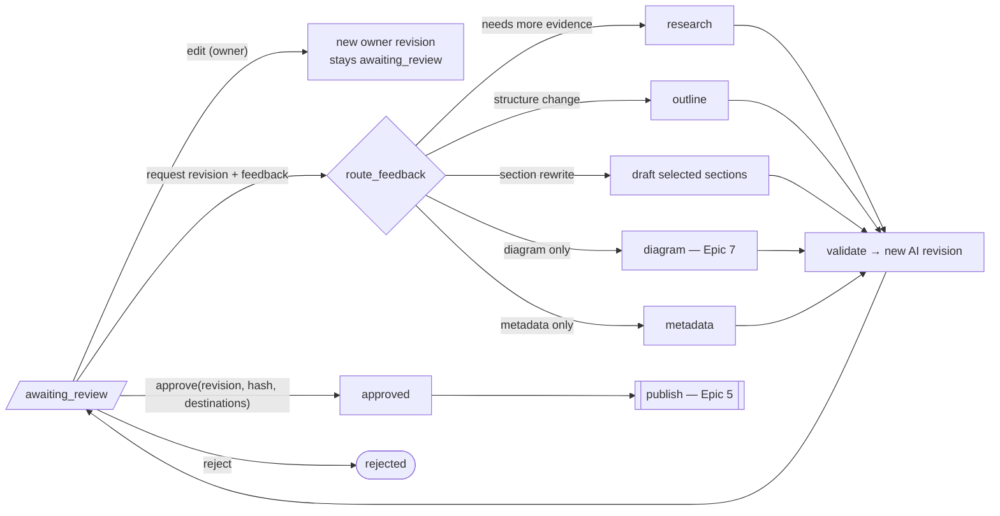

# Epic 4 — Human Review & Approval Gate

| | |
|---|---|
| **Milestone** | MVP |
| **Depends on** | Epic 3 |
| **Status** | Draft for review |

## Goal

The owner reviews each draft in a dashboard. The preview looks exactly as it will on the website. From there the owner can:

- edit the draft
- request targeted revisions
- regenerate parts of it
- reject it
- approve **one specific revision** for **specific destinations**

Approval is a server-enforced record bound to a content hash. It is the only thing that unlocks publishing (Epic 5).

## Context
- The workflow is paused at `interrupt()` (Epic 3). Review actions resume it with `Command(resume=...)`.
- The preview must reuse profile-ui's rendering pipeline: `MarkdownComp`, `MermaidRenderer`, `.prose-post` styles, KaTeX, and the Prism `tomorrow` theme. Without that, "what I approve" might not be "what readers see".
- profile-ui renders raw HTML unsanitised. The dashboard must sanitise, because drafts contain model output derived from web content.

## In scope
- Review page.
- Preview that matches the site.
- Editor and owner revisions.
- Diff between revisions.
- Sources, claims and evaluation panels.
- Revision feedback with routing.
- Approve and reject.
- Approval invalidation rules.

## Out of scope
- Publishing execution (Epic 5).
- Diagram regeneration UI (Epic 7).

---

## Review actions → workflow



---

## Stories

### E4-S1 — Site-accurate preview component
**As** the owner, **I want** the dashboard preview to render exactly like my website, **so that** I approve what readers will actually see.

**Acceptance criteria**
- [ ] `features/preview` ports profile-ui's rendering setup:
  - `remark-gfm`, `remark-math`, `rehype-katex`, `rehype-slug`
  - the same `normalizeMarkdown` behaviour
  - Mermaid rendering (dark theme)
  - Prism with the same grammars
  - `.prose-post` styles and the H1/cover layout
- [ ] `rehype-sanitize` runs with an allowlist that matches the render contract (Epic 3). The preview displays a warning badge when sanitisation removed something.
- [ ] Local asset paths (diagrams not yet uploaded) resolve through `GET /assets/{id}` on the API.
- [ ] A visual test with 3 fixtures (the existing `fine_tuning_concepts.md`, a tutorial, and a math-heavy post) shows no layout differences against profile-ui. Screenshots are compared manually and documented.
- [ ] `PROVENANCE.md` in the folder records the source commit of the copied code, so it can be re-synced later.

**Size:** 5

---

### E4-S2 — Review page layout
**As** the owner, **I want** one page that shows the draft, its evidence and its issues, **so that** I can review efficiently.

**Acceptance criteria**
- [ ] `/tasks/[id]/review` is built outside-in:
  - A header shows the title, status, revision selector (`r3 · AI · 2m ago · hash a1b2c3`) and action buttons.
  - The main area offers Preview, Edit and Split tabs.
  - A right sidebar has tabs for **Issues**, **Claims**, **Sources** and **Metadata**.
- [ ] Issues are grouped by severity and are clickable to scroll to the location.
- [ ] Claims list each statement with its support level (supported, partial, unsupported) and linked sources. Hovering highlights the sentence in the preview.
- [ ] Sources show quality and type. Each one shows which sections cite it, and has an "open" link.
- [ ] Logic lives in `use-review.ts` hooks. Server data comes from React Query, and UI state (selected tab, highlighted claim) from a Zustand `review-store` with `devtools`.

**Size:** 5

---

### E4-S3 — Owner edits create new revisions
**As** the owner, **I want** to edit the Markdown and metadata directly, **so that** I can polish wording myself without asking the AI.

**Acceptance criteria**
- [ ] The Markdown editor is CodeMirror 6 (Markdown mode) with a split live preview. Metadata (title, description, slug, tags) is edited in an RHF + Zod form.
- [ ] Save calls `POST /tasks/{id}/revisions` with `{base_revision_id, markdown, metadata}`.
  - The server creates a revision with `created_by=owner` and a new `content_hash`, then re-runs **deterministic validators** (fast, no LLM).
  - If `base_revision_id` is not the latest, the server returns `409`. This prevents lost updates.
- [ ] The workflow thread is not resumed by an edit. The task stays `awaiting_review` and the checkpoint state is updated to point at the new latest revision.
- [ ] An unsaved draft is kept in local state and in `localStorage` (content only, no secrets) to survive a reload. The owner is warned before navigating away.

**Size:** 3

---

### E4-S4 — Revision history & diff
**As** the owner, **I want** to compare revisions, **so that** I can check that the AI changed only what I asked.

**Acceptance criteria**
- [ ] The revision selector lists every revision with author, time, short hash and a feedback summary.
- [ ] A diff view between any two revisions shows a line-level diff of the Markdown (`diff` lib) and metadata changes.
- [ ] A "sections changed" summary appears after AI revisions. An AI revision that touched sections outside the requested scope is flagged.

**Size:** 3

---

### E4-S5 — Request revision with feedback & stage routing
**As** the owner, **I want** to give feedback and have the agent redo only the right part, **so that** revisions are fast and don't break good sections.

**Acceptance criteria**
- [ ] `POST /tasks/{id}/review` takes the following body:

  ```json
  {"action": "revise", "revision_id": "...", "feedback": "...",
   "scope": {"sections": ["2. How LoRA works"], "target": "auto|research|outline|draft|metadata|diagram"}}
  ```

- [ ] The server validates that `revision_id` is the latest revision and that the state is `awaiting_review`. It then moves the task to `revision_requested` and resumes the graph with `Command(resume={...})`.
- [ ] The `route_feedback` node works as follows:
  1. If `target=auto`, it classifies the feedback into a target stage using structured output. Otherwise it uses `target` directly.
  2. It jumps to that stage.
  3. When the target is `draft`, it rewrites only the scoped sections, which are given the feedback, the current text and the relevant claims.
- [ ] A research target re-uses existing sources and searches only for new questions derived from the feedback. Budgets apply.
- [ ] The result is a new AI revision (`parent_revision_id` = the reviewed revision). Validation and the judge re-run, and the task returns to `awaiting_review`.
- [ ] Feedback text is stored with the revision. It is also attached to the LangSmith run as feedback/metadata, which Epic 9 uses.
- [ ] Revision rounds are capped at `max_review_rounds`, default 10. The cap is a safety net, not a product limit.

**Size:** 5

---

### E4-S6 — Approve a revision for specific destinations
**As** the owner, **I want** to approve exactly this revision for chosen destinations, **so that** nothing else can be published by mistake.

**Acceptance criteria**
- [ ] The approval dialog shows:
  - revision number and short hash
  - title and slug
  - destinations as checkboxes (from `publication_targets`)
  - the Dev.to mode (`draft` / `published`, Epic 8)
  - any open blocker issues, which must be acknowledged with a checkbox
- [ ] Confirming the dialog requires typing the slug or clicking a "Yes, approve r3" button. A single click is not enough.
- [ ] `POST /revisions/{id}/approvals` takes `{destinations: [...], content_hash, options}`. It returns `201`, or `409` if:
  - the server-recomputed hash ≠ the submitted `content_hash`
  - the revision is not the latest
  - the task is not in `awaiting_review`
- [ ] For each destination, the server creates one `approvals` row: `article_revision_id`, `content_hash`, `destination`, `options`, `decision=approved`, `reviewed_at`, and `reviewer_id="owner"`.
- [ ] The task moves to `approved`. The graph resumes with `Command(resume={"action":"approve"})` and ends in a waiting state for publishing (Epic 5).

**Size:** 3

---

### E4-S7 — Approval invalidation rules
**As** the owner, **I want** approvals to become void if the content changes, **so that** an approval can never cover text I didn't see.

**Acceptance criteria**
- [ ] Any new revision (owner edit or AI revision) on an `approved` or `published` task:
  - moves the task to `awaiting_review`
  - marks existing approvals for older revisions as `superseded`
- [ ] `ApprovalGate.check(revision_id, destination)` is a domain service used by Epic 5. It passes only if all of these hold:
  1. An approval with `decision=approved` exists for that revision and destination, and is not superseded.
  2. `approval.content_hash` equals the recomputed hash of the stored revision.
  3. The revision is the task's latest.
- [ ] Unit tests cover: approve then edit (fails), approve r2 then publish r3 (fails), a hash tampered in the DB (fails), wrong destination (fails), and the happy path (passes).

**Size:** 2

---

### E4-S8 — Reject / archive task
**As** the owner, **I want** to reject a draft or cancel a task, **so that** abandoned ideas don't clutter my queue.

**Acceptance criteria**
- [ ] `POST /tasks/{id}/review` with `{"action":"reject","reason":"..."}` moves the task to `rejected` and ends the graph thread.
- [ ] Rejected tasks are hidden from the default task list but kept, with revisions and sources, under a "Show archived" filter.
- [ ] A rejected task can be **cloned** into a new task, with prefilled inputs and an option to reuse its sources.

**Size:** 2

---

## Definition of done (epic)
- The owner can complete the full loop in the UI: review, edit, request a scoped revision, compare the diff, then approve r(n) for Sanity.
- The `approvals` table shows the exact hash.
- After an approval, an edit voids it, and the gate tests pass.
- The preview matches the live site on the three fixtures.

## Learning map
| Tool | Concepts |
|---|---|
| LangGraph | `interrupt()` / `Command(resume=…)`, `Command(goto=…)` for feedback routing, updating checkpoint state on owner edits, ending threads |
| LangChain | Classification via structured output, partial (section-level) regeneration prompts |
| LangSmith | Attaching human feedback to runs |
