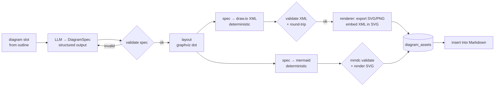

# Epic 7 — Editable Diagrams

| | |
|---|---|
| **Milestone** | M3 |
| **Depends on** | Epic 3 (diagram slots in the outline), Epic 4 (review UI), Epic 5 (asset upload) |
| **Status** | Draft for review |

## Goal

Generate technical diagrams the owner can **edit**. The model produces a structured **diagram spec**. Deterministic code then validates it and converts it into:

- **draw.io XML**: the editable source, plus an exported SVG/PNG for the article
- **Mermaid**: inline in the Markdown, for diagrams the site can render natively

Diagrams can be regenerated or replaced without rewriting the article.

## Context (confirmed from `blogs/`)
- The owner already uses **both** formats:
  - `blogs/fine_tuning/diagrams/*.drawio` with exported `.svg`, embedded as images
  - many inline ` ```mermaid ` flowcharts with `<b>` labels and `style … fill:#0369a1` colouring
- profile-ui renders Mermaid client-side. **Dev.to does not render Mermaid**, so Epic 8 needs an SVG/PNG fallback that this epic produces.
- A `drawio` skill exists in `profile/.agents/skills/drawio`. Check it for conventions before implementing.
- Rendering tools (the draw.io desktop CLI and the Mermaid CLI) need a headless browser or Electron. They run in a separate `renderer` container, keeping the API image slim.

## In scope
- Diagram spec schema and validator.
- Layout.
- draw.io XML generator and validator.
- Mermaid generator and validator.
- Renderer container (SVG/PNG export).
- Asset storage.
- Review UI to regenerate, replace and download diagrams.
- Content-hash integration.

## Out of scope
- Free-form illustration or image generation.
- Diagram types beyond flowchart, architecture and sequence in this epic.

---

## Pipeline



---

## Stories

### E7-S1 — Diagram spec schema & validator
**As** a developer, **I want** diagrams modelled as validated structured data, **so that** model mistakes are caught before any XML exists.

**Acceptance criteria**
- [ ] The `DiagramSpec` Pydantic model contains:
  - `type`: `flowchart` \| `architecture` \| `sequence`
  - `title`
  - `direction`: `LR` \| `TB`
  - `nodes[]`: `{id, label, kind: process|decision|datastore|service|actor|external|note, group?}`
  - `groups[]`: `{id, label, parent?}`
  - `edges[]`: `{from, to, label?, style: solid|dashed, arrow: one|both|none}`
  - for sequence diagrams: `participants[]` and `messages[]`
  - `style_preset`: `owner_dark` (default)
- [ ] Validator rules:
  - unique ids
  - edges and groups reference existing ids
  - no group cycles
  - labels of 60 chars or fewer, with line breaks allowed
  - at most 30 nodes and 50 edges
  - no orphan nodes unless their kind is `note`
  - sequence messages reference participants
- [ ] The `generate_diagram_spec` node takes the diagram slot (purpose, section text, claims) and uses `with_structured_output(DiagramSpec)`. On validation failure it gets at most 2 repair attempts, and the validator errors are fed back.

**Size:** 3

---

### E7-S2 — Deterministic layout
**As** the owner, **I want** diagrams laid out cleanly without manual dragging, **so that** the exported image is readable as-is.

**Acceptance criteria**
- [ ] The spec is converted to Graphviz DOT, using clusters for groups and `rankdir` from `direction`. `dot -Tjson` is run to get node positions and sizes. Edge routes are optional: draw.io can route orthogonally itself.
- [ ] The layout is deterministic: the same spec always produces the same coordinates (snapshot test).
- [ ] Node sizes are computed from label length and font metrics, to avoid overflowing text.
- [ ] Graphviz is installed in the API image (`graphviz` apt package). This is small.

**Size:** 3

---

### E7-S3 — draw.io XML generator & validator
**As** the owner, **I want** a `.drawio` file that opens and edits cleanly in diagrams.net, **so that** I can tweak diagrams myself.

**Acceptance criteria**
- [ ] The generator emits `<mxfile host="app.diagrams.net"><diagram><mxGraphModel>…` with root cells `0` and `1`, then the following cells:
  - one `mxCell vertex="1"` per node, with style taken from the `kind` and `style_preset`
  - groups as containers (`container=1`), with children carrying `parent` set to the group
  - edges as `mxCell edge="1"` with `edgeStyle=orthogonalEdgeStyle` and labels
- [ ] The `owner_dark` style preset matches the palette of the existing diagrams. Extract its colours from `blogs/fine_tuning/diagrams/*.drawio`.
- [ ] The validator parses with `lxml` and checks unique ids, that every `source`/`target` exists, that every `parent` exists, and that geometry is present.
- [ ] A **round-trip check** parses the XML back into a node/edge set, which must equal the spec.
- [ ] Manual acceptance: 3 generated files open in diagrams.net with no errors and stay editable.

**Size:** 5

---

### E7-S4 — Renderer service (draw.io → SVG/PNG, Mermaid validate/render)
**As** a developer, **I want** a local renderer container, **so that** exports are produced reliably without manual steps.

**Acceptance criteria**
- [ ] A `renderer` service is added to Compose. It is internal only, with no host port.
  - Option A (preferred): a small FastAPI/Node wrapper around the **draw.io desktop CLI** (`drawio -x -f svg --embed-diagram`, headless with xvfb) and `@mermaid-js/mermaid-cli` (`mmdc`).
  - Option B: the prebuilt `rlespinasse/drawio-export` image plus a separate Mermaid CLI image.
  - Pick one after a spike and record the decision.
- [ ] The service exposes:
  - `POST /render/drawio` (XML → SVG with the **diagram embedded**, so the SVG itself re-opens in diagrams.net; also PNG at 2×)
  - `POST /render/mermaid` (code → SVG/PNG; a syntax error returns a structured error)
- [ ] Each render has a 30 s timeout and at most 2 concurrent renders. Output is size-checked (≤ 2 MB) and SVGs are sanitised (no `<script>`, no `on*` attributes, no external `href`).
- [ ] The API client adapter implements `IDiagramRenderer`. If the renderer is down, the diagram step fails gracefully: the article continues without the diagram and an issue is flagged.

**Size:** 5

---

### E7-S5 — Mermaid generation from spec
**As** the owner, **I want** simple diagrams emitted as Mermaid in my usual style, **so that** they render natively on my site and stay editable as text.

**Acceptance criteria**
- [ ] A deterministic `spec → mermaid` converter supports `flowchart` (with `subgraph` for groups) and `sequenceDiagram`. It applies the owner's conventions: `<b>` titles in labels, `<br/>` line breaks, and `style` lines with the `owner_dark` palette.
- [ ] Every Mermaid block (generated **or** written by the model in Epic 3) is validated through the renderer. Invalid blocks trigger a repair attempt, then become a blocker issue.
- [ ] A rendered SVG is stored alongside each Mermaid block, for Dev.to (Epic 8).
- [ ] Format choice per slot: `auto` picks Mermaid when the diagram has 12 nodes or fewer and no nested groups, and draw.io otherwise. A task option can override this (`diagram_format`).

**Size:** 3

---

### E7-S6 — Diagram assets, insertion & content hash
**As** the owner, **I want** diagrams stored with their sources and included in the revision hash, **so that** approving an article also approves its diagrams.

**Acceptance criteria**
- [ ] The `diagram_assets` table holds:
  - `id`, `task_id`, `article_revision_id`
  - `slot_id`, `format` (`drawio` \| `mermaid`)
  - `spec` (json)
  - file paths under `data/assets/<task_id>/`: `source_path` (`.drawio` / `.mmd`), `svg_path`, `png_path`
  - `sha256` for each file
  - `validation_status`
  - `created_at`
- [ ] draw.io diagrams are inserted as ``. Epic 5 replaces these with CDN URLs at publish time. Mermaid diagrams are inserted inline as fences.
- [ ] The `content_hash` (E3-S8) includes `diagram_asset_hashes[]`, so changing a diagram means a new revision and a new approval.
- [ ] `GET /assets/{id}` serves the files to the dashboard with the correct content type and `Content-Disposition` for downloads.

**Size:** 3

---

### E7-S7 — Review UI: preview, regenerate, replace, download
**As** the owner, **I want** to fix a diagram without touching the article text, **so that** diagram iterations are quick.

**Acceptance criteria**
- [ ] A Diagrams tab in the review sidebar shows each diagram as a thumbnail, with its spec summary, format and validation status.
- [ ] Each diagram has these actions:
  - **Regenerate with feedback**: resumes the graph with `target=diagram` (E4-S5). Only that slot changes, producing a new revision.
  - **Switch format** (mermaid ↔ draw.io).
  - **Download** `.drawio` / `.svg` / `.png`.
  - **Replace by upload**: an edited `.drawio` or `.svg` (with embedded diagram) is validated with the same XML validator, rendered and sanitised. The result is a new owner revision.
- [ ] A hint links to diagrams.net for editing the downloaded file locally.

**Size:** 3

---

## Definition of done (epic)
- For the example "LoRA fine-tuning" task, the agent produces one draw.io architecture diagram and one Mermaid flowchart, and both pass validation.
- The `.drawio` file opens and edits in diagrams.net.
- The SVG renders on the site after publishing.
- Regenerating one diagram changes no article text.

## Learning map
| Tool | Concepts |
|---|---|
| LangChain | Strict structured output for complex nested schemas, repair loops with validator feedback |
| LangGraph | Sub-steps for a slot (could become a **subgraph** `diagram_subgraph`, the first justified use of one), targeted re-entry via `Command(goto=…)` |
| LangSmith | Tracking diagram repair rate as a quality metric |
