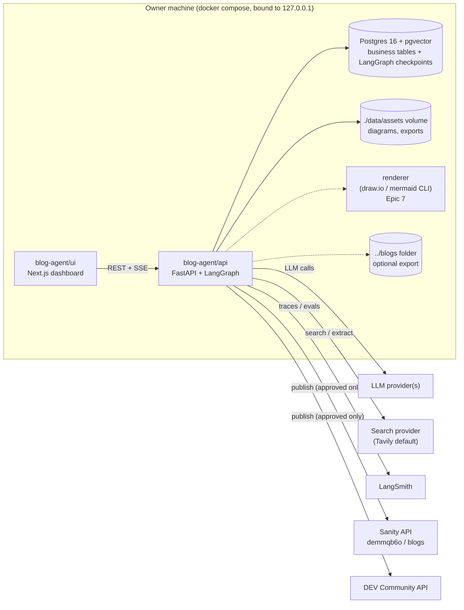

# Blog Agent — Epics Overview

> Source brief: [requirement.md](requirement.md)
> Status: **DRAFT for owner review**
> Last updated: 2026-10-21

The Blog Agent is a **personal, locally-run** AI technical writer. The owner starts it on their machine (Docker Compose), opens a dashboard, and asks it — whenever needed — to **research a topic** or **research + write a blog post**. Every post waits for explicit approval of an exact revision before it is published to Sanity (the website) and/or DEV Community.

---

## 1. Current-state assessment (confirmed facts)

| Area | Fact | Source |
|---|---|---|
| Website | Next.js 15.1 (App Router), React 19, Tailwind + shadcn, deployed on Vercel at https://leon-pham.vercel.app/ | `profile-ui/package.json` |
| Content source | Sanity project `demmqb6o`, dataset `blogs`, Studio v3.68 | `profile-cms/sanity.config.ts` |
| Post schema | `post`: `title`, `description`, `image` (cover), `images[]` (`alt`, `caption`), `tags[]` (`{_type:'tag', value}`), `publishedAt`, `updatedAt`, `content` (**plain text holding Markdown**). No slug, no author, no validation. `category` type exists but is unused. | `profile-cms/schemaTypes/postType.ts` |
| Rendering | `react-markdown` + `remark-gfm`, `remark-math`, `rehype-raw`, `rehype-katex`, `rehype-slug`; ` ```mermaid ` fences rendered client-side; Prism grammars: bash, java, javascript, json, markdown, python, typescript; `normalizeMarkdown` **merges consecutive lines into one paragraph**; images must be absolute URLs | `profile-ui/components/post/MarkdownComp.tsx` |
| Routing | `/blogs` (cursor pagination by `publishedAt`), `/posts/[id]` where `id` = Sanity `_id` (no slug) | `profile-ui/app/posts/[id]/page.tsx` |
| Existing publish flow | Local-only `/blog-manager` page + `/api/publish` route: reads `../blogs/**/*.md`, uploads local images to Sanity assets, rewrites paths to CDN URLs (and writes them back to the file), `create`/`createOrReplace` published docs, posts to Dev.to with `published:false`, stores ids in `blogs/.publish-meta.json` | `profile-ui/app/api/publish/route.ts` |
| Existing blog content | `blogs/fine_tuning/*.md` (2-part series), `diagrams/*.drawio` + exported `.svg`, heavy Mermaid usage, KaTeX, GFM tables, no frontmatter, title = first `# H1` | `blogs/` |
| Owner writing style | H1 → 1–2 framing paragraphs → numbered "Table of Contents" → numbered H2s (`## 1. ...` / `## Step 3: ...`) separated by `---`; "we" voice; bold key terms; analogies; "In simple terms" bullets; comparison tables; a diagram per concept; troubleshooting table (Problem / Cause / Solution); "Summary & What's Next" linking to the next part | `blogs/fine_tuning/*.md` |
| Gaps / risks found | No auth on blog-manager/publish routes; republish resets `publishedAt`; tags are a hard-coded heuristic; relative `.md` cross-links break on the site; site uses `rehype-raw` without sanitizing | profile-ui |

---

## 2. Target architecture



| Component | Responsibility | Why now |
|---|---|---|
| `blog-agent/api` (FastAPI, template `feat/fastapi`, hexagonal modules) | Task API, LangGraph workflow runner, revisions, approvals, publishing adapters. **Only place that holds secrets.** | Required by owner (fastapi skill) |
| LangChain | Model interface (`init_chat_model`), prompts, structured output, tools, retrievers | Required |
| LangGraph | Stateful workflow, conditional routing, `interrupt()` human review, Postgres checkpointer | Required; fits review/resume needs |
| LangSmith | Tracing from day 1, datasets + evaluations later | Required |
| `blog-agent/ui` (Next.js, nextjs skill) | Task form, live progress, review/edit/approve, publication status | Required by owner (nextjs skill) |
| Postgres (`pgvector/pgvector:pg16` image) | Durable records + checkpoints; pgvector extension enabled only in Epic 6 | One DB for everything keeps local ops simple |
| Local volume (not S3) | Diagram sources/exports | Local agent — S3 is unnecessary |
| Renderer container | draw.io → SVG/PNG, Mermaid validation/rendering | Only in Epic 7 |

**Explicitly NOT added:** Redis, Celery/queues, S3, NestJS, multi-agent / Deep Agents, user accounts. Long-running runs execute as in-process asyncio tasks and are durable through LangGraph's Postgres checkpointer.

### Proposed repository layout

```text
blog-agent/
├── api/                    # FastAPI (cloned from template feat/fastapi)
│   └── src/modules/
│       ├── health/
│       ├── tasks/          # WritingTask, status machine, run control
│       ├── agent/          # LangGraph graph, nodes, prompts, tools (workflow layer)
│       ├── research/       # sources, claims, search/extract adapters
│       ├── articles/       # revisions, validation, evaluations
│       ├── reviews/        # approvals (publication gate lives here + publications)
│       ├── publications/   # Sanity / Dev.to adapters, publish use cases
│       ├── styles/         # style profile, samples, retrieval (Epic 6)
│       └── diagrams/       # spec → draw.io/mermaid → SVG (Epic 7)
├── ui/                     # Next.js (pnpm, shadcn, React Query, Zustand, RHF+Zod)
├── renderer/               # Epic 7 (or a prebuilt image reference)
├── data/                   # mounted volume: assets/, exports/
├── docker-compose.yml
├── .env.example
├── Makefile
└── pdm/                    # this planning folder
```

---

## 3. Epic map

| # | Epic | Milestone | Goal | Depends on |
|---|---|---|---|---|
| 1 | [Foundation & Local Runtime](epic1_foundation/epic1_foundation.md) | MVP | `docker compose up` gives a working API, UI, DB, LLM config, LangSmith tracing | — |
| 2 | [Writing Tasks & Research Workflow](epic2_research_workflow/epic2_research_workflow.md) | MVP | Create a task; the agent plans and runs research, records traceable sources; research-only mode | 1 |
| 3 | [Outline, Drafting & Automated Checks](epic3_drafting/epic3_drafting.md) | MVP | Produce a site-compatible Markdown draft in the owner's style, validate it, pause for review | 2 |
| 4 | [Human Review & Approval Gate](epic4_review_approval/epic4_review_approval.md) | MVP | Preview/edit/revise/reject/approve a specific revision for specific destinations | 3 |
| 5 | [Sanity Publishing](epic5_sanity_publishing/epic5_sanity_publishing.md) | MVP | Publish approved revisions to Sanity idempotently; record results | 4 |
| 6 | [Personal Style & Knowledge Base](epic6_style_knowledge/epic6_style_knowledge.md) | M2 | Learn the owner's style from existing posts; retrieve relevant examples | 3 |
| 7 | [Editable Diagrams](epic7_diagrams/epic7_diagrams.md) | M3 | Spec → validated draw.io XML + SVG, and Mermaid; regenerate without rewriting | 3, 4 |
| 8 | [DEV Community Publishing](epic8_devto_publishing/epic8_devto_publishing.md) | M4 | Publish approved revisions to Dev.to safely | 5 |
| 9 | [Evaluation & Observability](epic9_evaluation_observability/epic9_evaluation_observability.md) | M5 | Datasets, evaluators, regression tracking, cost/latency visibility | 1–3 (tracing starts in Epic 1) |
| 10 | [Diagram Quality: draw.io-Native Rendering & Visual Review](epic10_diagram_quality/epic10_diagram_quality.md) | M3.1 | Publish the draw.io render itself, validated shape names, layout rules, vision review loop, diagram evals | 7, 9 |
| 11 | [Local Agent CLIs as LLM Providers (agy / Claude Code)](epic11_cli_llm_providers/epic11_cli_llm_providers.md) | M3.2 | Run any model role through the owner's logged-in `agy` or `claude` CLI instead of an API key | 1, 9 |
| 12 | [S3 Diagram Storage](epic12_s3_diagram_storage/epic12_s3_diagram_storage.md) | M3.2 | Diagram PNGs for Dev.to on S3 with permanent public URLs (instead of Sanity CDN SVGs); Mermaid `<b>` cleanup for Dev.to | 7, 8, 10 |
| 13 | [Website Blog on DEV (profile-ui)](epic13_devto_blog_site/epic13_devto_blog_site.md) | M3.2 | `/blogs` and `/posts/[slug]` read DEV instead of Sanity: views, reactions, comments; redesign; legacy redirects | 8, 12 |
| 14 | [Diagram Readability on DEV](epic14_diagram_readability_devto/epic14_diagram_readability_devto.md) | M3.2 | Keep draw.io diagrams within DEV's 800px image column (width budget feeds the regeneration loop), TB-first prompt, full-size link | 10, 12 |
| 15 | YouTube playlists on the website (planned) | M3.2 | profile-ui page listing the channel's videos grouped by playlist | 13 |
| — | Advanced agents (subgraphs, parallel research, Deep Agents) | M6 (parked) | Only if Epic 9 metrics show a measurable need | 9 |

**MVP = Epics 1–5.** In the MVP:
- The writer may already emit ` ```mermaid ` fences, because the site renders them natively. Full diagram generation and validation comes in Epic 7.
- The style comes from a static, hand-curated style guide (Epic 3). A learned style profile comes in Epic 6.

### Suggested delivery order

```text
E1 ──► E2 ──► E3 ──► E4 ──► E5   (MVP: first article published to Sanity)
                     │       └──► E8 (Dev.to)
                     ├──► E6 (style)
                     └──► E7 (diagrams) ──► E10 (diagram quality, needs E9 evals)
E1 (tracing) ─────────────────► E9 (evals)  — can start in parallel after E3
```

---

## 4. Refined data model (cross-epic)

| Table | Introduced in | Notes |
|---|---|---|
| `writing_tasks` | E2 | + `mode` (`research_only` \| `article`), `depth`, `format`, `include_diagram`, `budgets` (json), `graph_thread_id` |
| `task_events` | E2 | Status transitions + progress events (audit log, feeds SSE replay) |
| `research_sources` | E2 | As per brief + `source_type`, `quality_score`, `content_excerpt_hash` |
| `research_claims` | E2 | claim text, source ids, support level (`supported` / `partially` / `unsupported`) |
| `research_briefs` | E2 | Output of research-only mode |
| `article_revisions` | E3 | As per brief + `description`, `tags`, `metadata` json, `parent_revision_id`, `created_by` (`ai` \| `owner`) |
| `evaluation_results` | E3 | Per revision: validator issues + judge scores |
| `approvals` | E4 | Bound to `article_revision_id` + `content_hash` + `destination` (+ `mode` for Dev.to) |
| `publications` | E5 | Unique `(task_id, destination)`; remote id/url, attempts, rendered content hash |
| `writing_samples`, `sample_chunks` (vector) | E6 | pgvector enabled by migration in E6 only |
| `style_profiles` | E6 | Versioned, owner-editable |
| `diagram_assets` | E7 | Spec json, XML path, SVG/PNG paths, hashes, validation status |
| `run_usage` | E9 | Tokens/cost/latency per node per task |

LangGraph checkpoint tables live in a separate Postgres schema (`langgraph`). They are created by `AsyncPostgresSaver.setup()`, not by Alembic.

---

## 5. Decisions needed from the owner (please answer during review)

| # | Question | Recommendation |
|---|---|---|
| D1 | Which LLM provider(s)/models? (One for planning/writing, possibly a cheaper one for extraction/judging) | Make it configurable via `init_chat_model("<provider>:<model>")` and choose defaults at Epic 1 |
| D2 | Web search/extraction provider | **Tavily** (native LangChain integration, search + extract, free tier). Use `httpx` + `trafilatura` as the extraction fallback. Alternatives: Exa, Brave Search |
| D3 | Run mode | Full `docker compose up` for daily use. A hybrid dev mode (only Postgres in Docker, API/UI with hot reload) is also documented |
| D4 | Sanity publish target | Write a **published** document directly (matches today's flow). Optionally offer a "Sanity draft" destination (`drafts.<id>`) for a Studio check first |
| D5 | Sanity `_id` scheme | Use a deterministic, slug-like `_id` (e.g. `lora-fine-tuning-explained`). This makes publishing idempotent **and** gives readable `/posts/<id>` URLs with no schema change. No dots allowed, because dotted ids are private in Sanity |
| D6 | Keep the `blogs/` folder in sync? | Yes, as an optional export (`.md` + diagrams + `.publish-meta.json`) so the existing blog-manager and git history stay consistent |
| D7 | Local access control | Bind all ports to `127.0.0.1`, restrict CORS to the UI origin, and add an optional shared `AGENT_API_KEY`. No user accounts |
| D8 | Dev.to default | Create as unpublished draft (`published:false`, as today). Publishing live is a separate explicit approval mode |
| D9 | LangSmith data | Cloud LangSmith with full prompt/response tracing is fine for public-topic content? Otherwise add a redaction setting or allow tracing to be disabled |
| D10 | Planning folder name | You wrote `pdf/epicN_...`. These files are under the existing **`pdm/`** folder. Tell me if you want `pdf/` |

---

## 6. Global non-functional requirements (apply to every story)

- **Approval gate:** nothing reaches Sanity or Dev.to without a server-verified approval for the exact `content_hash` and destination.
- **Secrets:** API keys exist only in `api` env. They never appear in the UI bundle, prompts, graph state, traces or logs.
- **Untrusted input:** web pages and model outputs are data. Validate them with Pydantic schemas before use. Retrieved content never gets tools that can publish.
- **Budgets:** every loop has a cap. Defaults: max search queries, max sources, max self-revisions (2), max tokens/cost per task.
- **Conventions:** backend follows `blog-agent/.agents/skills/fastapi-skills` (hexagonal modules, DTOs with `to_entity()`, `@Transactional`, `BaseException`, Alembic, structured logging, rate limiting). Frontend follows `blog-agent/.agents/skills/nextjs-skills` (pnpm, shadcn, React Query, Zustand, RHF + Zod, `T`-prefixed types, outside-in layout).
- **Story sizing:** points use 1 / 2 / 3 / 5 / 8. An 8 is a candidate to split.
