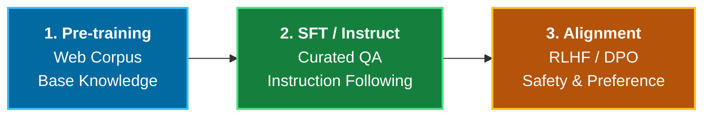
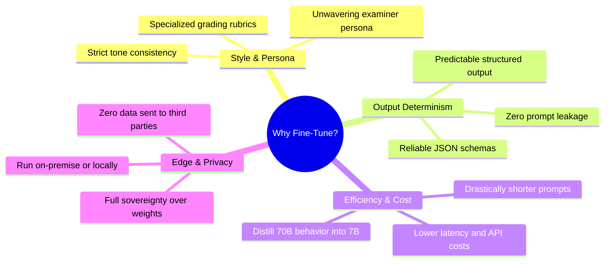
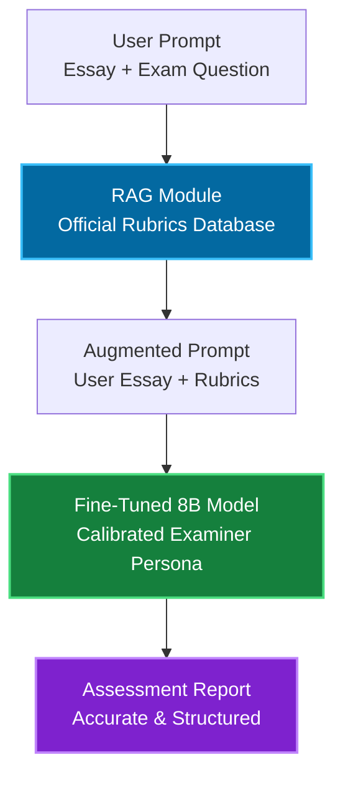
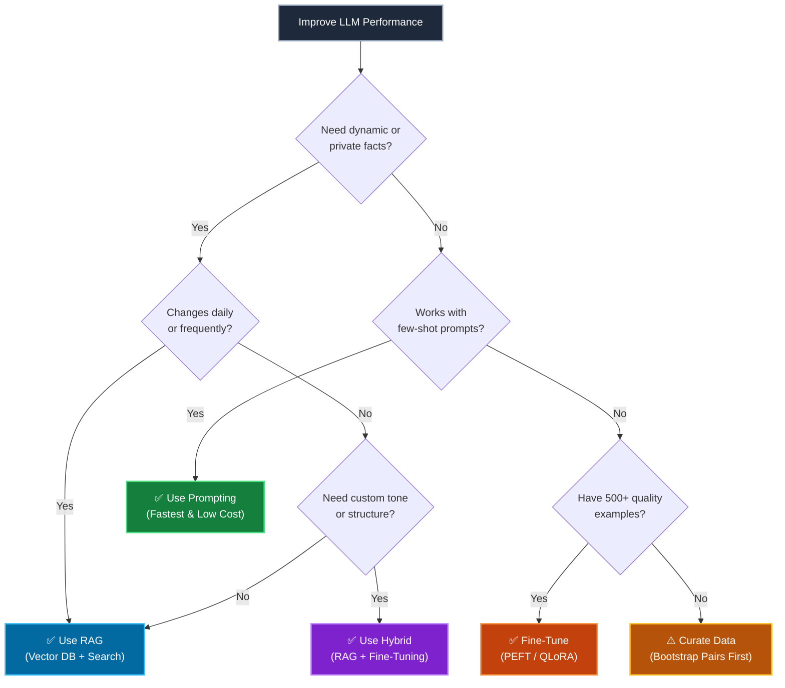
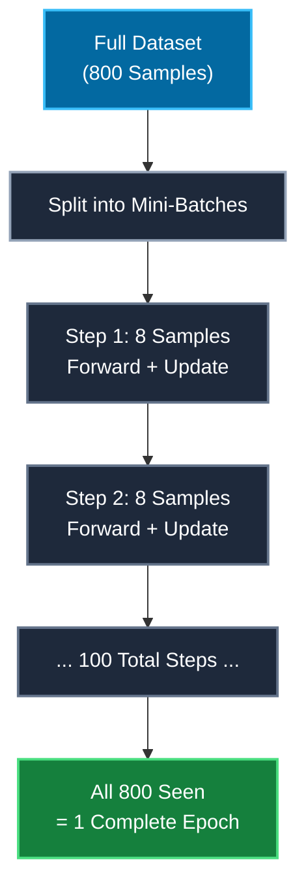

# LLM Fine-Tuning: Concepts, Architecture, and Fine-Tuning vs. RAG

Fine-tuning has emerged as one of the most critical skills for modern AI engineers. While large general-purpose foundation models (like GPT, Claude, or Qwen) are impressive out of the box, building production-grade domain applications often demands specialized behavior, deterministic formatting, or deep domain expertise that prompting alone cannot reliably achieve.

In this guide, we break down the foundational concepts of LLM fine-tuning, compare it with Retrieval-Augmented Generation (RAG), examine parameter-efficient training techniques (LoRA/QLoRA), and help you decide exactly when and when not to fine-tune.

---

## Table of Contents
1. [What is Fine-Tuning?](#1-what-is-fine-tuning)
   - [The LLM Training Lifecycle](#the-llm-training-lifecycle)
2. [Why Fine-Tune? Core Motivations](#2-why-fine-tune-core-motivations)
3. [Fine-Tuning vs. RAG](#3-fine-tuning-vs-rag)
   - [Core Mental Model: Open-Book vs. Closed-Book Exam](#core-mental-model-open-book-vs-closed-book-exam)
   - [Detailed Comparison](#detailed-comparison)
   - [The Hybrid Approach: RAG + Fine-Tuning](#the-hybrid-approach-rag--fine-tuning)
   - [Decision Framework: Which Should You Choose?](#decision-framework-which-should-you-choose)
4. [How an LLM Processes Input and Generates Output (Under the Hood)](#4-how-an-llm-processes-input-and-generates-output-under-the-hood)
   - [The End-to-End Inference Lifecycle](#the-end-to-end-inference-lifecycle)
   - [The Tokenization Mechanism: From Words to Numbers](#the-tokenization-mechanism-from-words-to-numbers)
   - [Internal Processing: Embeddings, Positional Encoding & Attention](#internal-processing-embeddings-positional-encoding--attention)
   - [The Prediction Loop: Logits, Softmax & Autoregressive Decoding](#the-prediction-loop-logits-softmax--autoregressive-decoding)
   - [Sampling Controls: Temperature, Top-p & Stop Tokens](#sampling-controls-temperature-top-p--stop-tokens)
5. [Methods of Fine-Tuning](#5-methods-of-fine-tuning)
   - [Full Parameter Fine-Tuning (FPFT)](#full-parameter-fine-tuning-fpft)
   - [Parameter-Efficient Fine-Tuning (PEFT) & LoRA](#parameter-efficient-fine-tuning-peft--lora)
   - [QLoRA: 4-bit Quantized LoRA](#qlora-4-bit-quantized-lora)
   - [Hardware Comparison: FPFT vs. LoRA vs. QLoRA](#hardware-comparison-fpft-vs-lora-vs-qlora)
6. [Essential Hyperparameters & Micro-Concepts](#6-essential-hyperparameters--micro-concepts)
   - [Epochs vs. Steps vs. Batch Size](#epochs-vs-steps-vs-batch-size)
   - [Gradient Accumulation & Effective Batch Size](#gradient-accumulation--effective-batch-size)
7. [When is Fine-Tuning Useful? (And When is it Not?)](#7-when-is-fine-tuning-useful-and-when-is-it-not)
   - [Best Scenarios for Fine-Tuning](#best-scenarios-for-fine-tuning)
   - [Scenarios Where You Should NOT Fine-Tune](#scenarios-where-you-should-not-fine-tune)
8. [Summary & What's Next](#8-summary--whats-next)

---

## 1. What is Fine-Tuning?

At its core, **fine-tuning** is the process of taking a pre-trained model (which already understands grammar, world facts, and language patterns from trillions of tokens) and training it further on a curated, domain-specific dataset to adapt its weights for a specific task, persona, or style.

### The LLM Training Lifecycle

Modern language models undergo a three-stage lifecycle:



1. **Pre-training (Base Models):** Models like `Llama-3-8B-Base` or `Qwen2.5-7B` read massive swaths of the internet. Their objective is raw next-token prediction. They complete sentences, but they cannot converse or reliably follow instructions.
2. **Supervised Fine-Tuning (SFT / Instruct Models):** The base model is trained on question-answer or multi-turn conversational datasets. This transforms a raw text completer into an assistant (`Llama-3-8B-Instruct`).
3. **Domain-Specific Fine-Tuning (Our Focus):** You take an Instruct model and fine-tune it on proprietary tasks—for example, evaluating IELTS essays according to strict Cambridge band descriptors.


---

## 2. Why Fine-Tune? Core Motivations

Why go through the effort of fine-tuning when we can simply write a prompt for GPT-4 or Claude?



1. **Strict Style and Persona Consistency:** Prompt engineering often suffers from "drift" or breaks character over extended contexts. Fine-tuning hardcodes the persona directly into the model's weights.
2. **Complex Output Formatting:** When your application requires a strict multi-section output, fine-tuned models produce the exact schema reliably without needing fragile retry loops.
3. **Prompt Compression & Latency Reduction:** With zero-shot prompting, you might need to send 2,000 tokens of rubrics, instructions, and few-shot examples with *every single API request*. Fine-tuning bakes those instructions into the model, cutting input prompt lengths by up to 80% and slashing latency and inference costs.
4. **Performance on Edge Hardware:** You can fine-tune a compact 7B or 8B model to rival or outperform a 70B+ generic model on your specific vertical task, allowing you to deploy on lightweight hardware or on-premise servers.
5. **Data Privacy & Governance:** Fine-tuning open-weight models allows enterprises to keep all sensitive customer data within their own Virtual Private Cloud (VPC) or local machine.

---

## 3. Fine-Tuning vs. RAG

One of the most frequent question in AI is: **"Should I use RAG or Fine-Tuning?"**

### Core Mental Model: Open-Book vs. Closed-Book Exam

* **RAG (Retrieval-Augmented Generation) is an Open-Book Exam:** The student has good general reasoning skills. When asked a question, they look up external manuals, company wikis, or database records and synthesize an answer based on what they just retrieved.
* **Fine-Tuning is Studying for the Exam (Internalized Expertise):** The student has memorized patterns, stylistic habits, and specialized procedural skills. When asked to perform, the reaction is instinctive and fast.

### Detailed Comparison

| Dimension | Retrieval-Augmented Generation (RAG) | Supervised Fine-Tuning (SFT) |
| :--- | :--- | :--- |
| **Primary Purpose** | Injecting **dynamic, up-to-date factual knowledge** | Modifying **form, behavior, tone, style, and reasoning patterns** |
| **Knowledge Freshness** | **Real-time:** Update your vector database, and the model instantly accesses new documents | **Static:** Knowledge is frozen at training time; updating requires retraining |
| **Hallucination Mitigation** | High: Grounded directly in retrieved source chunks with explicit citations | Moderate: Can still hallucinate facts if trained on noisy or contradictory data |
| **Cost Profile** | Low upfront setup; higher recurring per-query cost (longer context embeddings & tokens) | Higher upfront compute cost; lower recurring query cost (shorter prompts, smaller models) |
| **Latency** | Slower (Vector search + Embedding generation + Large context window) | Faster (Direct inference with compact prompts) |
| **Context Window Consumption**| High (Passages and reference chunks occupy prompt tokens) | Low (Knowledge and rules are internal to the model) |

### The Hybrid Approach: RAG + Fine-Tuning

In modern production systems, RAG and Fine-Tuning are **not mutually exclusive**—they are complementary:



* Use **Fine-Tuning** to teach the model **HOW** to behave (e.g. grade like an official Cambridge examiner, never give generic praise, generate exact JSON).
* Use **RAG** to feed the model **WHAT** facts or reference materials to consult (e.g. the specific exam version question, updated vocabulary).

### Decision Framework: Which Should You Choose?

Use this decision tree to pick the right strategy:



---

## 4. How an LLM Processes Input and Generates Output (Under the Hood)

To understand how fine-tuning alters a model's behavior, we must first understand how an LLM natively receives text, processes it through its neural architecture, and generates a response.

### The End-to-End Inference Lifecycle

When you ask an LLM to evaluate an IELTS essay, the following cycle occurs:


#### Architectural Flow Breakdown:

```mermaid
flowchart LR
    In["1. User Prompt<br/>(Raw String)"] --> Tok["2. Tokenizer<br/>(BPE / IDs)"]
    Tok --> Emb["3. Embedding<br/>+ RoPE"]
    Emb --> Trans["4. 28 Layers<br/>(Attention + LoRA)"]
    Trans --> Head["5. LM Head<br/>(Logits)"]
    Head --> Soft["6. Softmax<br/>(Temp T=0.3)"]
    Soft --> Sam["7. Next Token<br/>(Top-p=0.9)"]
    Sam --> Loop{"Stop Token<br/>&lt;|im_end|&gt;?"}
    Loop -- No --> Trans
    Loop -- Yes --> Out["8. Output Essay<br/>Review Report"]

    style In fill:#0f172a,stroke:#38bdf8,stroke-width:2px,color:#f8fafc;
    style Tok fill:#1e293b,stroke:#818cf8,stroke-width:2px,color:#f8fafc;
    style Emb fill:#1e293b,stroke:#a855f7,stroke-width:2px,color:#f8fafc;
    style Trans fill:#14532d,stroke:#4ade80,stroke-width:2px,color:#f8fafc;
    style Head fill:#1e293b,stroke:#38bdf8,stroke-width:2px,color:#f8fafc;
    style Soft fill:#7c2d12,stroke:#fb923c,stroke-width:2px,color:#f8fafc;
    style Sam fill:#581c87,stroke:#c084fc,stroke-width:2px,color:#f8fafc;
    style Loop fill:#334155,stroke:#94a3b8,stroke-width:2px,color:#f8fafc;
    style Out fill:#0f172a,stroke:#4ade80,stroke-width:2px,color:#f8fafc;
```


---

### The Tokenization Mechanism: From Words to Numbers

Neural networks cannot process raw characters or words directly; they only perform linear algebra on numbers. 

#### Why Not Words or Characters?
* **Word-level tokenization:** The vocabulary would be infinite. It would fail completely on typos, hyphenated words, or domain jargon (e.g. *"lexicalization"*).
* **Character-level tokenization:** Sequences become too long (each letter is an input), and individual characters convey minimal semantic meaning.

#### The Modern Solution: Subword Tokenization (Byte-Pair Encoding - BPE)
Modern models (like Qwen 2.5 and Llama 3) use **Byte-Pair Encoding (BPE)**. Frequent words remain single tokens, while rare words are broken into meaningful subword chunks:

| Original Word | Subword Breakdown | Why? |
| :--- | :--- | :--- |
| `"education"` | `["education"]` | Common word; assigned its own dedicated token ID. |
| `"unquestionably"` | `["un", "question", "ably"]` | Split into common prefix, root, and suffix tokens. |
| `"overemphasizing"` | `["over", "emphas", "izing"]` | Common subword stems combined flexibly. |

#### Example: Tokenizing an IELTS Prompt
When you send:
```text
IELTS Writing Task 2: Plastic pollution is damaging oceans.
```
The tokenizer consults its dictionary table and produces an array of integer **Token IDs**:
```python
[38384, 18274, 8431, 220, 17, 25, 27329, 21890, 374, 21950, 24590, 13]
```

#### Special Tokens in ChatML Templates
In conversational models, special delimiter tokens tell the model who is speaking. Without special tokens, the model cannot distinguish between instructions and candidate essays:

* `<|im_start|>system` : Marks the start of the Senior Examiner rubric persona.
* `<|im_start|>user` : Marks the candidate essay and prompt.
* `<|im_start|>assistant` : Signals the model that it is now its turn to generate the score report.
* `<|im_end|>` : **The Stop Token.** Signals that generation is complete.

---

### Internal Processing: Embeddings, Positional Encoding & Attention

Once text is tokenized into IDs:

1. **Embedding Lookup Matrix ($W_e \in \mathbb{R}^{V \times d_{\text{model}}}$):**
   Each token ID is mapped to a continuous, high-dimensional vector. For example, in an 8B model with $d_{\text{model}} = 4096$, the integer `38384` becomes a vector of 4,096 floating-point numbers encoding its base semantic meaning.
2. **Rotary Positional Embeddings (RoPE):**
   Self-attention on its own is order-agnostic ("dog bites man" would look identical to "man bites dog"). RoPE mathematically rotates the embedding vectors in complex coordinate space so the model knows the exact position and distance of each word in the sequence.
3. **Multi-Head Self-Attention (The Core Engine):**
   Each token projects into **Query ($Q$)**, **Key ($K$)**, and **Value ($V$)** vectors:

   $$\text{Attention}(Q, K, V) = \text{softmax}\left(\frac{QK^T}{\sqrt{d_k}}\right)V$$

   This allows the token `"congestion"` to attend back to `"traffic"` and forward to `"delays"`, capturing deep contextual grammar and semantic dependencies across the entire essay.

---

### The Prediction Loop: Logits, Softmax & Autoregressive Decoding

LLMs do not produce a whole paragraph in a single forward pass. They are **autoregressive**: they generate text **one single token at a time**.

#### 1. From Hidden States to Logits
After passing through all 28–36 transformer layers, the model extracts the final hidden state vector corresponding to the very last token.

This vector passes through the **Language Model Head (`lm_head`)**, which calculates raw confidence scores (called **logits**) for each of the 152,000+ words in the model's vocabulary.

#### 2. From Logits to Probabilities (Softmax)
Because raw logits can be negative, zero, or arbitrary numbers, the model passes them through the **Softmax function** to turn them into clean percentages (probabilities) between 0% and 100% that all add up to 1.0 (100%).

In simple terms:
* Words with higher logit scores receive higher probabilities.
* The **Temperature ($T$)** setting controls how bold or conservative the model is: a low temperature concentrates probability onto the top word (more focused and deterministic), while a higher temperature spreads probability more evenly (more creative).

---

### Sampling Controls: Temperature, Top-p & Stop Tokens

Once we have a probability distribution over the 152,000 candidate tokens, how do we pick the winner?

```
Candidate Tokens:
  "###"        -> 64.2%  <-- Most likely next token!
  "Overall"    -> 21.5%
  "The"        -> 8.1%
  "Candidate"  -> 4.3%
  "banana"     -> 0.000001% (Cut off by Top-p)
```

#### 1. Temperature ($T$)
* **Low Temperature ($T = 0.1 - 0.3$):** Sharpen the distribution! The highest probability token becomes overwhelmingly favored. This provides **deterministic, consistent grading**—essential for IELTS examiner scoring.
* **High Temperature ($T = 0.8 - 1.2$):** Flatten the distribution! Lower-probability words get a higher chance to be chosen, creating creative, diverse storytelling (but increasing the risk of hallucinations).
* **Greedy Decoding ($T = 0$):** Strictly pick the token with the highest probability ($\arg\max$).

#### 2. Top-p (Nucleus Sampling)
Instead of considering all 152,000 tokens, the model pools only the top tokens whose cumulative probability adds up to $p$ (e.g., $p = 0.90$). The remaining 10% "long tail" of weird or irrelevant words is discarded, eliminating bizarre hallucinations.

#### 3. Stop Tokens (`<|im_end|>`)
How does the generation loop know when to finish?
When the model concludes its final revision paragraph, it predicts the special token `<|im_end|>`. The inference engine recognizes this stop token, halts the loop, and triggers the **Detokenizer** to convert all generated token IDs back into human-readable text on your screen.


## 5. Methods of Fine-Tuning

### Full Parameter Fine-Tuning (FPFT)

In Full Parameter Fine-Tuning, every single parameter in the model is updated.
* **Problem:** An 8-Billion parameter model stored in 16-bit float requires:
  * Model weights: $8 \times 2\text{ GB} = 16\text{ GB}$
  * Gradient tensors: $16\text{ GB}$
  * Optimizer states (AdamW tracks 2 momentum variables per weight): $8 \times 8\text{ GB} = 64\text{ GB}$
  * Activations & buffers: $\approx 16\text{ GB}$
  * **Total VRAM required: > 110 GB!** (Requires multi-A100 server clusters).

### Parameter-Efficient Fine-Tuning (PEFT) & LoRA

In 2021, Microsoft researchers published **LoRA (Low-Rank Adaptation)**.

The core insight: The weight updates $\Delta W$ during domain adaptation have a low "intrinsic dimension" (rank). Instead of updating the full weight matrix $W_0 \in \mathbb{R}^{d \times k}$, LoRA decomposes the update into two low-rank matrices $A$ and $B$:

$$\Delta W = B \cdot A$$

Where $B \in \mathbb{R}^{d \times r}$ and $A \in \mathbb{R}^{r \times k}$, with rank $r \ll \min(d, k)$.

```
   Original Weight Matrix W (Frozen)            LoRA Adapter Matrices (Trainable)
        [ d x k ]                                    B [ d x r ]   x   A [ r x k ]
  (Millions of parameters)                           (e.g., r = 16: ~0.5% of parameters)
```

* During training, $W_0$ is frozen (requires no optimizer states).
* Only $A$ and $B$ receive gradient updates.
* Memory usage for optimizer states drops by **over 95%**!

### QLoRA: 4-bit Quantized LoRA

Introduced by Dettmers et al. (2023), **QLoRA** takes LoRA further by combining:
1. **4-bit NormalFloat (NF4):** Quantizes the frozen base model weights from 16-bit down to 4-bit without noticeable perplexity degradation.
2. **Double Quantization (DQ):** Quantizes the quantization constants themselves, saving an additional 0.37 bits per parameter.
3. **Paged Optimizers:** Uses CUDA Unified Memory to automatically page memory between GPU and CPU RAM during gradient spikes.

With QLoRA, an 8-Billion parameter model requires only **~5.5 GB VRAM** for weights, allowing full fine-tuning on a single **free Google Colab T4 GPU (15 GB VRAM)**!

### Hardware Comparison: FPFT vs. LoRA vs. QLoRA

| Technique | Precision of Base Model | Trainable Parameters | GPU VRAM Required (8B Model) | Can run on Free Colab T4? |
| :--- | :--- | :--- | :--- | :--- |
| **Full Fine-Tuning** | 16-bit FP16/BF16 | 100% (8.0B) | ~110 GB+ | ❌ No (Requires multiple A100s) |
| **Standard LoRA** | 16-bit FP16/BF16 | ~0.5% – 2% (40M) | ~24 GB – 32 GB | ❌ No (Requires A10G / L4 / V100) |
| **QLoRA** | 4-bit NF4 | ~0.5% – 2% (40M) | **~7 GB – 10 GB** | ✅ **Yes (Runs smoothly on T4 15GB)** |

---

## 6. Essential Hyperparameters & Micro-Concepts

When beginning LLM fine-tuning, you will encounter parameters and configuration options that look familiar from traditional machine learning, but carry distinct rules of thumb in modern LLM training.

### Epochs vs. Steps vs. Batch Size

To understand how fine-tuning progresses, you must grasp how data flows into the model:



* **Epoch:** **One complete cycle** through the entire training dataset. If your dataset has 1,000 examples, 1 epoch means the model has seen all 1,000 examples exactly once.
* **Step (Iteration):** **A single weight update**. One step consists of:
  1. Passing a batch of data through the model (*Forward Pass*).
  2. Calculating loss and computing gradients (*Backward Pass*).
  3. Updating the model weights using the optimizer.

The simple calculation formula is:

> **Total Training Steps** = `(Total Examples * Number of Epochs) / Effective Batch Size`

*Example:* If you have 800 essays, train for 3 epochs, and use an effective batch size of 8:

> **Total Steps** = `(800 * 3) / 8 = 300 steps`

---


### Gradient Accumulation & Effective Batch Size

On consumer GPUs like the Colab T4 (15 GB VRAM), setting a physical batch size of 16 or 32 for an 8B model will immediately trigger an **Out-Of-Memory (OOM)** error. 

However, a tiny batch size (like 1 or 2) makes the gradient updates noisy. How do we solve this? **Gradient Accumulation.**

* **Per-Device Batch Size ($B_{\text{device}}$):** The number of samples loaded into GPU memory at any single moment (e.g., 2).
* **Gradient Accumulation Steps ($G$):** Instead of updating weights after every single batch, the optimizer computes gradients for $G$ batches, *accumulates (sums) the gradients in memory*, and only updates the weights once every $G$ steps!

> **Effective Batch Size** = `Per-Device Batch Size * Gradient Accumulation Steps * Number of GPUs`


---

## 7. When is Fine-Tuning Useful? (And When is it Not?)

### Best Scenarios for Fine-Tuning
1. **Domain Assessment & Scoring:** e.g., IELTS, TOEFL, SAT essays, or coding interview grading adhering to specific rubrics.
2. **Complex Schema Adherence:** Enforcing strict, unvarying JSON, YAML, or XML output without preamble or conversational fluff.
3. **Domain Vocabulary & Tone:** Medical triage dialogues, legal clause rewriting, financial auditing tone.
4. **Latency & Edge Deployments:** Shrinking prompt sizes so a compact model can be deployed locally on laptops with Ollama.

### Scenarios Where You Should NOT Fine-Tune
1. **Dynamic / Fast-Changing Knowledge:** Stock prices, company product catalogs, weather, news. *Use RAG instead.*
2. **General Fact Retrieval:** Fine-tuning on facts frequently induces subtle hallucinations. *Use RAG instead.*
3. **Insufficient Data:** If you have fewer than 100 examples, few-shot prompting in Claude or GPT-4 will almost always outperform a fine-tuned model.

---


## 8. Summary & What's Next

| Core Concept | Summary Takeaway |
| :--- | :--- |
| **What is it?** | Adapting model weights to internalize style, structure, and specialized reasoning. |
| **RAG vs. FT** | RAG brings the facts (open book); Fine-Tuning shapes the behavior and skill (retained mastery). |
| **Epochs & Steps** | LLMs only need 1–3 epochs; gradient accumulation achieves large effective batch sizes on limited VRAM. |

In **[Part 2: Step-by-Step Implementation Guide](fine_tuning_implementation.md)**, we will implement a complete end-to-end training pipeline using **Unsloth**, **QLoRA**, and **Google Colab**, training our own custom **IELTS Examiner AI**.
