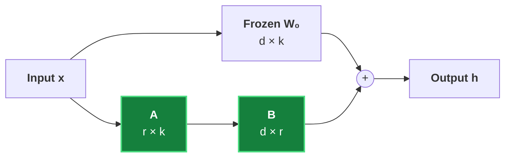

# The Mathematics of LoRA: Low-Rank Updates Explained

Full fine-tuning updates every weight of a model. LoRA asks a sharper question: how much of that update actually matters?

## Table of Contents

1. [The Weight Update](#1-the-weight-update)
2. [Low-Rank Factorisation](#2-low-rank-factorisation)
3. [Parameter Savings](#3-parameter-savings)

---

## 1. The Weight Update

A pretrained layer computes $h = W_0 x$ with $W_0 \in \mathbb{R}^{d \times k}$. Fine-tuning learns an update $\Delta W$:

$$
h = W_0 x + \Delta W x
$$

The LoRA paper observes that $\Delta W$ has a low *intrinsic rank*, so we never need to store it densely.

---

## 2. Low-Rank Factorisation

We write the update as the product of two thin matrices:

$$
\Delta W = B A, \quad B \in \mathbb{R}^{d \times r},\; A \in \mathbb{R}^{r \times k},\; r \ll \min(d, k)
$$

The forward pass becomes:

$$
h = W_0 x + \frac{\alpha}{r} B A x
$$

| Symbol | Meaning |
| :--- | :--- |
| $r$ | Rank of the update (typically 4–64) |
| $\alpha$ | Scaling factor that keeps the update size stable across ranks |
| $A$ | Initialised with a Gaussian |
| $B$ | Initialised to zero, so training starts from $\Delta W = 0$ |

```python
import torch

d, k, r, alpha = 4096, 4096, 8, 16
A = torch.randn(r, k) * 0.01
B = torch.zeros(d, r)
delta_w = (alpha / r) * (B @ A)
print(delta_w.shape)  # torch.Size([4096, 4096])
```

---

## 3. Parameter Savings

For one $4096 \times 4096$ projection, full fine-tuning trains $d \cdot k = 16{,}777{,}216$ parameters. With $r = 8$:

$$
r(d + k) = 8 \times 8192 = 65{,}536 \quad \Rightarrow \quad \frac{65{,}536}{16{,}777{,}216} \approx 0.39\%
$$



> Only $A$ and $B$ receive gradients; $W_0$ stays frozen, which is why optimiser memory drops so sharply.

---

## References

1. [LoRA: Low-Rank Adaptation of Large Language Models](https://arxiv.org/abs/2106.09685) — arXiv
